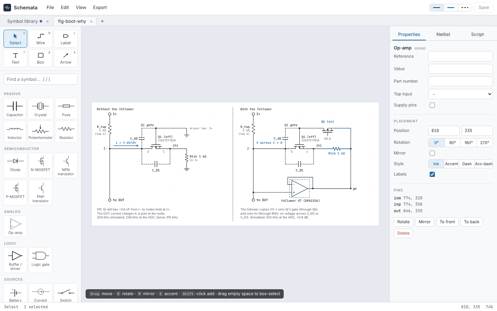

# Schematrix

An electrical schematic editor in the Instrix house style (the look of the TR-0002 figures), with a Python
scripting library behind it. The same core renders, netlists and serves the GUI, so a schematic drawn by hand and
one built by a script are the same kind of document.



- **GUI**: browser-based editor — symbol palette, wires that snap to pins and follow parts when moved, KiCad-style
  wire dragging (grab an end to stretch it, a segment to slide it), junction dots and optional wire hops, net labels,
  group boxes, notes, undo/redo, tabs, themes, netlist view, and a Python script pane.
- **Symbols**: ~95 parts and ~50 named variants, each its own palette tile and Python method — resistors (variable,
  thermistor, varistor, LDR, Kelvin shunt), capacitors (polarized, electrolytic), inductors, transformers, diodes
  (rectifier, Zener, Schottky, LED, TVS uni/bidirectional, avalanche, photodiode, varactor, tunnel, PIN, laser,
  step-recovery, Shockley), bridges, SCR / triac / diac, BJTs, MOSFETs (enhancement / depletion, 4-terminal), JFETs,
  IGBTs, optocouplers, op-amps, comparators, in-amps, regulators, independent and dependent sources, batteries,
  current sinks, loads, motors, lamps, meters, switches, relays, connectors, antennas, vacuum tubes, signal-flow
  blocks, Thévenin / Norton equivalents, two-ports.
- **Logic**: AND / NAND / OR / NOR / XOR / XNOR (2–16 inputs, ANSI or IEC shapes, any inputs inverted), buffers,
  NOT and Schmitt inverters, tri-state buffers, D / JK / T flip-flops, SR and D latches, registers and latch arrays,
  shift registers (SIPO / PISO / universal), counters, decoders, priority encoders, multiplexers and
  demultiplexers, adders, magnitude comparators — all with configurable widths, as bus pins or one pin per bit —
  plus a custom logic IC whose pins you type (`D[8], >CLK, ~OE`). Wires have a thick bus style.
- **Fields**: any part can carry extra fields (tolerance, voltage rating, footprint, …); each can be shown on the
  sheet, and they travel with the netlist.
- **Netlists**: export and import SPICE, KiCad `.net` and a JSON netlist — from the editor, the API, the CLI or Python.
  An imported netlist becomes a new sheet with every net labelled.
- **Scripting**: `from schematrix import Schematic` — place parts, reach pins as `part['pin']`, route wires,
  save JSON / SVG / PNG / PDF / SPICE. Scripts run from the editor, the CLI, or plain Python / Jupyter.
- **Legacy import**: figure scripts written against the old hand-rolled `S` class (like `schematics.py`) run
  unchanged and come out as editable documents, pixel-identical to the originals.
- **Runs** as a Docker web app, or natively on Windows and Linux (own window via pywebview).

## Install

Needs Python 3.10 or newer. Schematrix is not on PyPI; it installs straight from this repository. The repository
is private, so pip needs your GitHub access: an SSH key (`git+ssh://`, shown below) or HTTPS with a personal access
token (`git+https://<token>@github.com/...`).

### Extras

| Extra | Adds | When you need it |
|---|---|---|
| *(none)* | editor, server, scripting, SVG and SPICE export | always enough to work |
| `export` | `cairosvg` | PNG and PDF export from the server and the CLI |
| `desktop` | `pywebview`, `cairosvg` | the native window (`schematrix` with no arguments) |
| `dev` | `pytest`, `httpx`, `pillow`, `numpy` | running the tests |

Without `desktop`, `schematrix` opens the editor in your default browser instead. In the editor, PNG export
still works without `export` (it is drawn in the browser); PDF needs it.

### pipx (recommended for using the app)

[pipx](https://pipx.pypa.io) installs the `schematrix` command in its own isolated environment and puts it on your
PATH:

```bash
pipx install "schematrix[desktop] @ git+ssh://git@github.com/Instrix/instrtix-schematrix.git"
schematrix                                   # opens the editor
pipx upgrade schematrix                      # later: update to the latest main
```

Pin a release with `...instrtix-schematrix.git@v0.1.0`.

### pip in a virtual environment (recommended for scripting)

Use a venv when you want to `import schematrix` from your own scripts or notebooks.

Linux / macOS:

```bash
python3 -m venv .venv
source .venv/bin/activate
pip install "schematrix[export] @ git+ssh://git@github.com/Instrix/instrtix-schematrix.git"
```

Windows (PowerShell):

```powershell
py -m venv .venv
.venv\Scripts\Activate.ps1
pip install "schematrix[export] @ git+ssh://git@github.com/Instrix/instrtix-schematrix.git"
```

To add it to a project's `requirements.txt`:

```
schematrix[export] @ git+ssh://git@github.com/Instrix/instrtix-schematrix.git@v0.1.0
```

### From a clone (for development)

```bash
git clone git@github.com:Instrix/instrtix-schematrix.git
cd instrtix-schematrix
python3 -m venv .venv && source .venv/bin/activate      # Windows: py -m venv .venv; .venv\Scripts\Activate.ps1
pip install -e ".[dev,desktop]"                          # editable: code changes apply without reinstalling
pytest -q
```

### Platform notes

- **Windows**: the native window uses WebView2, preinstalled on Windows 10 and 11. `cairosvg` needs the Cairo DLL;
  if PNG/PDF export reports a missing `libcairo-2.dll`, install GTK3 for Windows (or use MSYS2's `mingw-w64-x86_64-cairo`)
  and put its `bin` folder on PATH. If you skip it, you can still export SVG, and PNG from the editor.
- **Linux**: for the native window, install your distribution's WebKitGTK bindings, e.g. on Debian/Ubuntu
  `sudo apt install python3-gi gir1.2-webkit2-4.1` (Fedora: `python3-gobject webkit2gtk4.1`; Arch:
  `python-gobject webkit2gtk-4.1`). Schematrix finds them even from a pipx or venv install, as long as that uses
  the system Python. Alternatively use Qt: `pipx inject schematrix qtpy pyqt6 pyqt6-webengine`. With neither,
  `schematrix` says so and opens the editor in your browser. Cairo is usually already installed (`libcairo2`). For PNG/PDF that match the editor, install the fonts
  too: `sudo apt install fonts-jetbrains-mono fonts-inter`.
- **macOS**: works too (`brew install cairo` for PNG/PDF); the native window uses the system WebKit.

## Quick start

```bash
schematrix                                   # native window (falls back to the browser)
schematrix serve --open                      # web server on http://127.0.0.1:8000
schematrix serve --host 0.0.0.0 --port 8080 --workspace ~/drawings
python -m schematrix --help                  # same as the schematrix command
```

The workspace (default `~/Schematrix`, `/data` in Docker) holds saved `.json` schematics and `.py` scripts. On first
run it is seeded with `examples/`: the twelve TR-0002 figures and a sample script.

### Docker

```bash
docker compose up -d                   # development: builds this checkout, http://localhost:8000
```

For a server, use the deployment template in `deploy/`: the published image, a required access token, a hardened
container (read-only filesystem, no capabilities, memory / CPU limits, log rotation), the port bound to localhost,
and an optional Caddy front end with automatic HTTPS:

```bash
cp deploy/.env.example deploy/.env     # set SCHEMATRIX_TOKEN (openssl rand -hex 24), image version, limits
docker login ghcr.io                   # the image is private
docker compose -f deploy/docker-compose.yml up -d                    # http://localhost:8000/?token=...
docker compose -f deploy/docker-compose.yml --profile https up -d    # + HTTPS for SCHEMATRIX_DOMAIN
```

Documents, scripts and custom symbols live in the `schematrix_data` volume; the header of
`deploy/docker-compose.yml` shows how to update and back up.

### Public instance (no token)

To let anyone use it anonymously, run it in public mode with `deploy/docker-compose.public.yml`:

```bash
docker compose -f deploy/docker-compose.public.yml up -d             # http://<host>:8000, no token, no volume
```

Public mode (`SCHEMATRIX_PUBLIC=1`) is safe because of what the server will not do, not because of a password:

- **no code execution**: scripts and legacy-script import are off, whatever `SCHEMATRIX_SCRIPTS` says;
- **nothing stored on the server**: visitors keep their sheets in their own browser and File > Save downloads a
  `.json` (File > Open file brings it back); the bundled examples are served read-only; custom symbols are off;
- **bounded work**: per-visitor request rates, request and document sizes, bitmap export size and the number of
  exports running at once are capped (`SCHEMATRIX_PUBLIC_RATE`, `_HEAVY_RATE`, `_MAX_BODY`, `_MAX_ELEMENTS`,
  `_MAX_SCALE`, `_MAX_PIXELS`, `_PARALLEL`);
- **hardened output**: raw SVG in documents is stripped of scripts, exports are served sandboxed, the app page gets
  a strict content security policy.

Before going public, check:

1. **Image access.** The image on ghcr.io is private: the host needs `docker login ghcr.io` (a GitHub token with
   `read:packages`), or uncomment `build: ..` in the compose file to build from a checkout.
2. **HTTPS.** Point a DNS name at the host, open ports 80 and 443, and start with the `https` profile:
   ```bash
   SCHEMATRIX_DOMAIN=schematrix.example.org SCHEMATRIX_TRUST_PROXY=1 SCHEMATRIX_BIND=127.0.0.1 \
     docker compose -f deploy/docker-compose.public.yml --profile https up -d
   ```
   - `SCHEMATRIX_BIND=127.0.0.1` makes the app reachable only through the proxy.
   - `SCHEMATRIX_TRUST_PROXY=1` makes the rate limits use each visitor's address instead of the proxy's.
3. **Never trust the proxy header without the proxy.** With `SCHEMATRIX_TRUST_PROXY=1` and the app port reachable
   directly, visitors can fake their address in `X-Forwarded-For` and get around the rate limits. Turn it on only
   together with `SCHEMATRIX_BIND=127.0.0.1` behind the proxy.
4. **One container.** Rate limits and the export queue are counted inside each container. Run a single container;
   with several behind a load balancer, each keeps its own counts, so the effective limits multiply (rate-limit at
   the load balancer instead).
5. **Tune the limits** for your hardware and audience if needed (`SCHEMATRIX_PUBLIC_*` above; memory and CPU with
   `SCHEMATRIX_MEMORY`, `SCHEMATRIX_CPUS`).

| Variable | Default | |
|---|---|---|
| `SCHEMATRIX_WORKSPACE` | `~/Schematrix` (`/data` in Docker) | documents and scripts |
| `SCHEMATRIX_SCRIPTS` | `1` | allow the editor to run Python on the server |
| `SCHEMATRIX_TOKEN` | unset | if set, every request needs it: open `/?token=…` once (sets a cookie) or send `Authorization: Bearer …` |
| `SCHEMATRIX_SCRIPT_TIMEOUT` | `30` | seconds per script |
| `SCHEMATRIX_PUBLIC` | `0` | anonymous public instance: no scripts, nothing stored on the server, limits (see above) |
| `SCHEMATRIX_TRUST_PROXY` | `0` | rate-limit by the `X-Forwarded-For` address a reverse proxy appends; only behind one |

Scripts are arbitrary Python running on the server (in a child process with a timeout and, on Linux, memory/CPU
limits). On anything shared, set `SCHEMATRIX_TOKEN` or `SCHEMATRIX_SCRIPTS=0`.

### Native builds (Windows / Linux / macOS)

```bash
pip install ".[desktop]" pyinstaller
pyinstaller packaging/schematrix.spec    # -> dist/Schematrix/Schematrix(.exe)
```

The CI workflow (`.github/workflows/release.yml`) runs the tests, builds the Windows, Linux and macOS bundles and
pushes the Docker image on a `v*` tag (or on demand from the Actions tab). Windows uses WebView2 (preinstalled on
Windows 10/11), macOS its built-in WebKit; on Linux the app opens a Chromium app window when Chrome / Chromium is
installed, else GTK WebKit (`gir1.2-webkit2-4.1`), else the browser.

## Scripting

```python
from schematrix import Schematic

s = Schematic('RC filter and buffer')
vin = s.flag((60, 120), 'VIN', side='left')
r1 = s.resistor((130, 120), value='1 kΩ')                         # ref R1 assigned automatically
c1 = s.capacitor(anchor='1', at=(200, 120), rot=90, value='10 nF')  # put pin 1 at (200, 120)
s.gnd(c1['2'])
u1 = s.opamp(anchor='inp', at=(280, 120), top='+', part='OPA210')
s.wire(vin['p'], r1['1'])
s.wire(r1['2'], u1['inp'])                                         # junction dots are automatic
s.route(u1['out'], (380, 160), how='hv', style='acc')              # orthogonal routing; 'acc' = accent blue
s.note(60, 230, 'f_c ≈ 15.9 kHz')

s.save('rc.json'); s.save_svg('rc.svg'); s.save_pdf('rc.pdf')
print(s.spice())
```

- Fields: `s.resistor(..., fields={'Tolerance': ('1%', True), 'Power': '0.25 W'})` (`True` = show on the sheet),
  then `r.field('Power')`, `r.field('Power', '0.5 W', show=True)`, `r.remove_field('Power')`.
- Netlists: `s.export_netlist('kicad')`, `s.save_netlist('board.net')`, `Schematic.from_netlist('deck.cir')`.
- Variants are methods too: `s.zener(...)`, `s.nand_gate(inputs=3, shape='iec')`, `s.shiftreg_sipo(bits=16, bus=True)`;
  the document stores the base symbol plus props, so `schematrix symbols` and the palette list both.
- Every symbol is a method: `s.resistor`, `s.nmos`, `s.opamp`, `s.vsrc`, `s.gate(kind='nand', inputs=3)`,
  `s.block(w=, h=, title=, pins='IN:l, OUT:r')`, … — `schematrix symbols` lists them with their pins and properties.
- Placement: `at`, `rot` (0/90/180/270), `mirror`, `anchor=<pin>`; `style` = `''`, `'acc'`, `'para'` (dashed).
- Annotation: `text`, `note`, `heading`, `rect` (group shading), `group([parts], label=)`, `arrow`, `raw(svg)`.
- Page: `Schematic(title, width, height, theme=…)`, `.page(...)`, `.fit()`; themes `instrix`, `instrix-dark`,
  `blueprint`, `print-mono`, or a dict of token overrides.
- In the editor, every schematic a script creates (or passes to `show()`) opens as a tab.

## CLI

```
schematrix render fig.json -o fig.svg            # or .png .jpg .webp .pdf .eps .tikz .tex .cir .net
schematrix render build_figs.py -o out/ -f svg,pdf --background none --scale 3
schematrix app --engine chromium                 # app window: chromium (default on Linux) | webview | browser
schematrix netlist fig.json -f kicad -o fig.net  # spice (default) | kicad | json
schematrix import-netlist board.net -f json,svg   # draw a schematic from a SPICE / KiCad / JSON netlist
schematrix import-legacy schematics.py -o figs/  # old S-class scripts -> .json + .svg
schematrix symbols
```

## Drawing styles

A document's theme sets colours, fonts and line weights: `instrix` (default), `instrix-dark`, `blueprint`,
`print-mono`, `formal` (Times / LaTeX serif, thin lines, italic references, for papers), `technical` (Helvetica,
datasheet look) and `kicad` (KiCad's classic colours). Pick one in the document inspector or `Schematic(theme=…)`.

## Text markup

Every label, value, field, net name and note understands a small markup language (Help > Text markup, or F1):

| Type | Get |
|---|---|
| `~{RST}` | overbar (active low) |
| `V_{CC}`, `x^{2}` | subscript, superscript (they nest: `~{CS_{1}}`) |
| `4.7 k\ohm`, `10 \uF`, `25 \deg{}C` | Ω, µ, ° (`{}` ends a name) |
| `\pm \times \le \ge \approx \inf \sqrt` | ± × ≤ ≥ ≈ ∞ √ |
| `\alpha` … `\Omega` | Greek letters |
| `\-` | a true minus sign |
| `\~ \{ \} \_ \^ \\` | the literal characters |

Markers only count with a brace, so `f_c` stays as typed. SPICE netlists get the plain text (`10 k\ohm` -> `10k`),
TikZ gets LaTeX (`\overline`, `\textsubscript`).

## Export

File > Export… (Ctrl+E) or right-click > Export selection…: SVG, PNG, JPEG, WebP, PDF, EPS, TikZ (`\input` into a
LaTeX document) or a standalone `.tex`; the whole sheet or only the selection, cropped with a margin; the theme's
paper, white or a transparent background; bitmap scale up to 8x (768 dpi). Bitmaps are drawn in the browser, so
they work without cairosvg. From Python: `s.export('fig.pdf', ids=[...], background=False)`, `s.to_tikz()`;
over HTTP: `POST /api/export`.

## Simulation

A document carries SPICE lines (`s.directive('.tran 10u 5m')`, or "SPICE lines" in the document inspector) that
end up in the netlist. Default models are written for parts that use them (`DMOD`, `NPN`, `PNP`, `NMOS`, `PMOS`,
`NJF`, `PJF`, and an op-amp macro-model `OPAMP` / `OPAMP5`), unless you define your own `.model` / `.subckt`.

```
schematrix netlist examples/simulation/rc-step.py -o rc.cir && ngspice -b rc.cir
```

## Examples

`examples/` (copied into the workspace; new versions add new examples without touching yours) holds Python
scripts, each with ready-to-open `.json` documents beside it:

- **analog**: inverting amplifier, Sallen-Key low-pass, bridge + instrumentation amp, photodiode TIA, common emitter
- **digital**: SR latch, full adder, counter + decoder over a bus, shift register driving LEDs, debounce, accumulator,
  bus breakout (bus labels and bus entries)
- **power**: linear supply, buck converter, relay driver, high-side load switch
- **simulation** (verified with ngspice, results printed by `.meas`): RC step, RLC resonance, rectifier, CMOS
  inverter, op-amp integrator, diode clipper
- **misc**: triode preamp, signal-chain block diagram, a LaTeX paper figure, the same circuit in every style
- **netlists**: SPICE and KiCad files to try File > Import netlist on
- **tr-0002**: the original figure script (runs as-is, or imports as 12 editable figures)

`python scripts/build_examples.py` regenerates the `.json` documents and sample netlists.

## Buses

Draw a bus with the thick wire style (a wire started on a bus pin, or on a bus, becomes one by itself). Label it
`D[7:0]` (or `D[0..7]`) and its members are the nets `D0` … `D7`:

- a component's bus pin (a register's `D[7:0]`, a mux's data inputs) connects bit by bit: pin bit *i* joins `D`*i*;
- a single wire joins a bit by carrying that bit's label (`D3`); draw the 45° tap with the **Bus entry** symbol;
- a plain wire that merely touches a bus is not connected to it, as in KiCad;
- buses labelled with the same base name are one bus; an unlabelled bus between two bus pins still connects them
  bit by bit. Width mismatches are reported in the netlist warnings.

## Editing

- **Mouse**: left drag moves, stretches wires or box-selects; right or middle drag pans; right-click opens the
  context menu; wheel zooms. Drag a symbol from the palette onto the sheet, or click it to place several.
- **Align and distribute** (Edit menu, right-click, or the inspector with several items selected): left / centre /
  right / top / middle / bottom, and even spacing; attached wires stretch along.
- **Find and replace** (Ctrl+F): references, values, net names, fields, texts; click a hit to jump to it.
- **Wires**: moving a part drags its wires, and wires that tee into those wires follow too.
- **Page frame**: Document inspector > Page frame: A5 … A1, Letter, Legal, Tabloid, portrait or landscape, with
  zone markers and a title block (title, company, document no., revision, author, date, sheet). Python:
  `s.frame('A4', title=…, rev=…)`.

## Custom symbols

File > New symbol…, right-click a palette tile, or "Customise symbol…" in the inspector opens the symbol editor:
draw lines, shapes, rectangles, circles and text, place pins, set the label position, prefix, suggested fields and an
optional SPICE line, then save to the library. Symbols are JSON files in the workspace's `symbols/` folder, appear in
the palette under Custom (right-click to edit), are usable from scripts by name (`s.my_symbol(…)`), and travel inside
every document that uses them, so the sheet opens anywhere. Python: `schematrix.symbols.custom.define(...)`.

## Layout

```
schematrix/
  symbols/      symbol library (single source of truth, served to the editor)
    core.py       Prop, Symbol, @symbol registry, primitives and drawing helpers
    passive.py semiconductor.py analog.py logic.py sources.py loads.py electromech.py tubes.py signal.py
    generic.py nets.py      one module per palette category (logic_block.py: the logic-block engine)
    custom.py     user-drawn symbols (JSON definitions, the workspace's symbols/ folder)
  geometry.py   placement maths, junctions, bounding boxes   (web/js/geom.js is its JS twin)
  render.py     document -> SVG (and PNG/PDF via cairosvg)
  document.py   the scripting API (Schematic, Comp, Pin)
  netlist.py    connectivity (which pins share a net, net names)
  markup.py     text markup (~{x}, V_{CC}, \ohm …), shared with web/js/markup.js
  export.py     every export format, selection cropping and backgrounds
  tikz.py       TikZ export
  frame.py      page frames and title blocks
  netio/        netlist files: model.py (neutral Netlist), spice.py, kicad.py, jsonfmt.py, layout.py (netlist -> sheet)
  units.py      engineering values ('1 kΩ' -> SPICE '1k')
  compat.py     legacy S-class importer
  runner.py     sandboxed script execution
  server.py     FastAPI: /api/symbols, /geometry, /render, /netlist, /netlist/export, /netlist/import, /run, /files …
                (docs at /api/docs)
  cli.py        command line + native launcher
  web/          the editor (vanilla ES modules, no build step) and the bundled JetBrains Mono / Inter fonts
    js/app.js     entry point; state, view, tools, selection, inspector, palette, panes, files, ui, commands,
                  util modules; geom.js is the JS twin of geometry.py
```

Adding a symbol is one decorated function in the fitting `symbols/` module returning primitives and pins; the editor
picks it up from `/api/symbols` with no front-end change. Give it a SPICE line template (`'R {1} {2} {value}'`),
KiCad pin numbers and library aliases, and suggested fields, and netlist export / import handle it too.

## Netlists

| Format | Export | Import |
|---|---|---|
| SPICE (`.cir`) | one line per part from its template; net names made SPICE-safe | elements by letter, `.model` types, subcircuits skipped |
| KiCad (`.net`) | version E, KiCad library names and pin numbers (`Device:R`, `Device:Q_NPN_BCE`, …) | by library part, then reference prefix; `Q_NPN_CBE`-style pin orders honoured; unknown parts become blocks |
| JSON | `{"format": "schematrix-netlist", "components": [...], "nets": [...]}` | the same |

Exports embed the Schematrix symbol, properties and fields (as `*@` comments in SPICE, component properties in
KiCad), so a netlist written here imports back without loss. API: `POST /api/netlist/export?format=kicad` with
`{"doc": …}` returns the file; `POST /api/netlist/import` with `{"text": …, "filename"?: …, "format"?: …}` returns
`{"doc", "format", "warnings"}`.

## Document format

```json
{"version": 1, "meta": {"title": "", "description": ""},
 "page": {"width": 800, "height": 500, "auto": false, "margin": 20, "grid": 5, "junctions": true, "hops": false},
 "theme": "instrix",
 "elements": [
   {"id": "e1", "type": "comp", "sym": "resistor", "x": 100, "y": 100, "rot": 0, "mirror": false,
    "props": {"ref": "R1", "value": "1 kΩ"}, "style": "",
    "fields": [{"name": "Tolerance", "value": "1%", "show": true}]},
   {"id": "e2", "type": "wire", "points": [[130, 100], [200, 100]], "style": "acc"},
   {"id": "e3", "type": "text", "x": 60, "y": 230, "text": "note", "cls": "note", "anchor": "start"}]}
```

Element types: `comp`, `wire`, `arrow`, `text`, `rect`, `raw`. Element order is drawing order.

Fonts: JetBrains Mono and Inter (SIL OFL 1.1, licences in `web/fonts/`).
