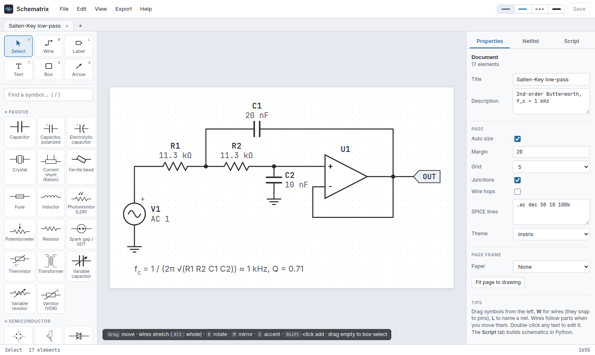
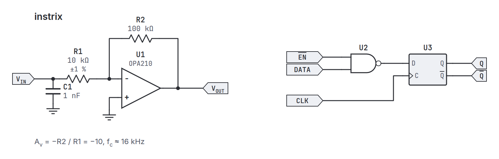
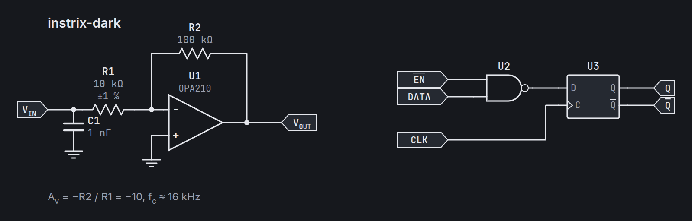
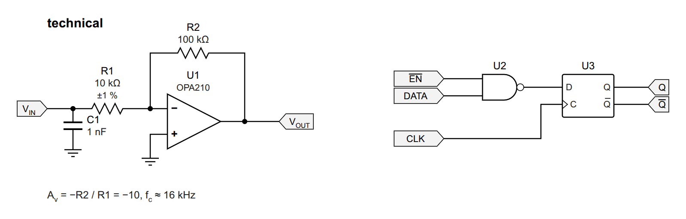
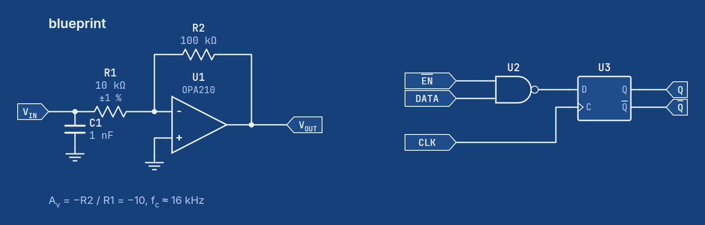
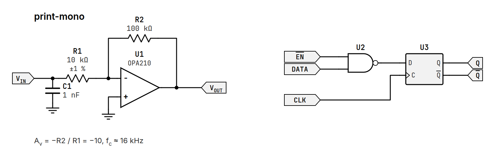
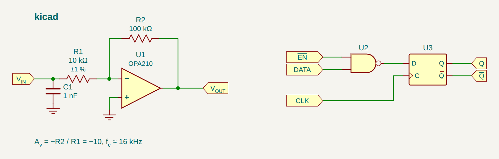
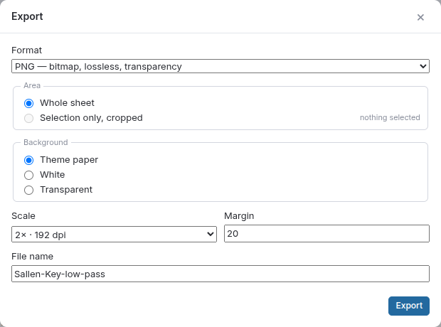
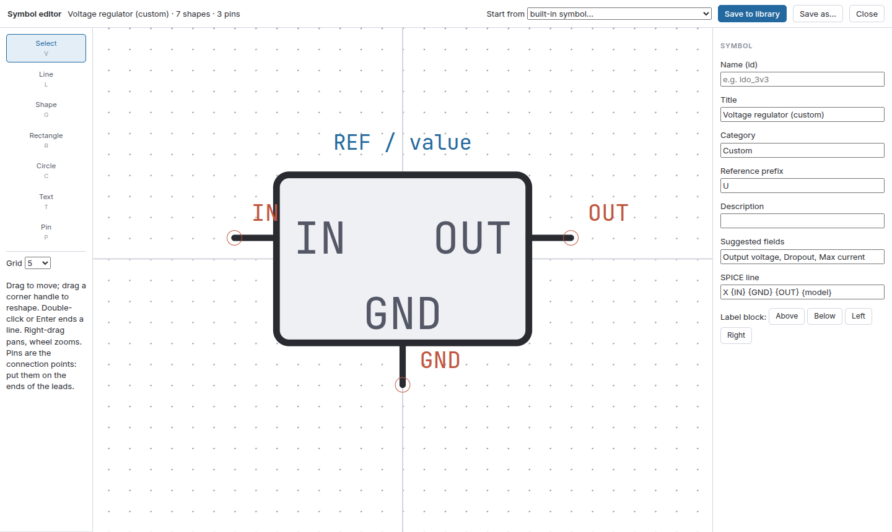
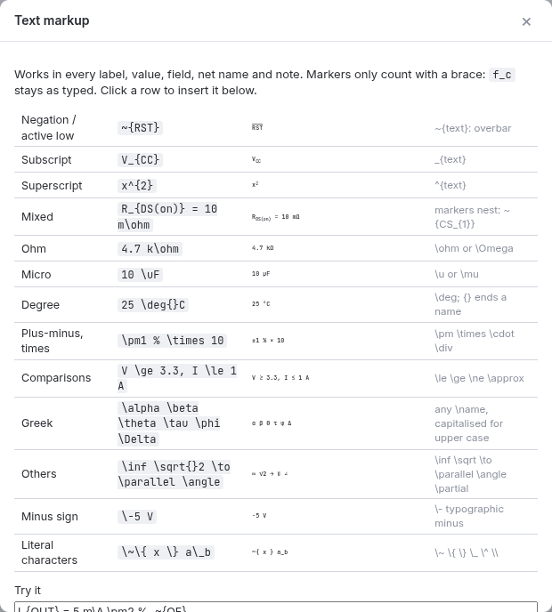

# Schematrix

An electrical schematic editor in the Instrix house style, with a Python scripting library behind it. The same core
renders, netlists and serves the GUI, so a schematic drawn by hand and one built by a script are the same kind of
document.



**Documentation: the [Schematrix wiki](docs/wiki/Home.md)** — every feature, how to draw, export, use the figures in
LaTeX, simulate, script and deploy.

- **Editor**: KiCad-style wiring (snap, stretch, junction dots, hops), buses, net labels, undo, tabs, find/replace,
  page frames, a symbol editor and a Python script pane — in the browser or its own desktop window.
- **Symbols**: ~150 parts and variants, from passives, diodes and transistors to op-amps, sources and tubes, plus
  configurable logic: gates, flip-flops, registers, counters, muxes and custom ICs, any width.
- **Output**: SVG, PNG, PDF, EPS and TikZ for LaTeX, in seven themes (including a Times/LaTeX one); SPICE, KiCad and
  JSON netlists in and out, ready for ngspice.
- **Scripting**: `from schematrix import Schematic` — the same documents from Python, the CLI or the HTTP API.
- **Runs** natively on Windows, Linux and macOS, or as a Docker web app (private or public).

## Free and open source, forever

Schematrix is free software under the [GNU GPL v3](LICENSE) (or any later version). It is free forever: no payments,
no subscriptions, no accounts, no "pro" edition and no locked features. Everything described here is in the download
and in this repository, for anyone to use, study, change and share.

## Made with AI

Schematrix was built with the help of AI (Anthropic's Claude) to solve one specific problem: no existing tool drew
schematics the way the Instrix documentation needs them, scriptable from Python and consistent across every figure.
It is tested (unit tests, pixel comparisons against the original figures, SPICE runs, builds on every platform), but
it is not a substitute for checking your drawings: review figures and netlists before you publish or build from them.

## Gallery

The same sheet in each built-in theme (`scripts/build_docs_images.py`):

| `instrix` (default) | `instrix-dark` |
|---|---|
|  |  |
| **`formal`** (Times, for LaTeX papers) | **`technical`** (datasheet look) |
|  |  |
| **`blueprint`** | **`print-mono`** |
|  |  |
| **`kicad`** | **TikZ export compiled with pdfLaTeX** |
|  |  |

| Export dialog | Symbol editor | Text markup |
|---|---|---|
|  |  |  |

The full symbol set, one picture per part and variant: [Symbol library](docs/wiki/Symbol-Library.md).

## Install

### Download the app

| System | Download | |
|---|---|---|
| Windows 10 / 11 | [Schematrix-Setup.exe](https://github.com/Instrix/Instrtix-Schematrix/releases/latest/download/Schematrix-Setup.exe) | installer; or the portable [.zip](https://github.com/Instrix/Instrtix-Schematrix/releases/latest/download/Schematrix-windows.zip) |
| Linux (any, x86-64) | [Schematrix-x86_64.AppImage](https://github.com/Instrix/Instrtix-Schematrix/releases/latest/download/Schematrix-x86_64.AppImage) | `chmod +x` and run |
| Debian / Ubuntu | [schematrix_amd64.deb](https://github.com/Instrix/Instrtix-Schematrix/releases/latest/download/schematrix_amd64.deb) | `sudo apt install ./schematrix_amd64.deb` |
| macOS (Apple silicon) | [Schematrix-macos.dmg](https://github.com/Instrix/Instrtix-Schematrix/releases/latest/download/Schematrix-macos.dmg) | drag to Applications; unsigned: first open with right-click > Open |

Each includes its own Python, the editor, the `schematrix` command line and PDF / PNG export. Older versions and
checksums: [Releases](https://github.com/Instrix/Instrtix-Schematrix/releases).

### With Python

Needs Python 3.10 or newer. Schematrix is not on PyPI; pip installs it straight from this repository (below), or
from the wheel attached to each release.

### Extras

| Extra | Adds | When you need it |
|---|---|---|
| *(none)* | editor, server, scripting, SVG and SPICE export | always enough to work |
| `export` | `cairosvg`, `pillow`, `fonttools`, `brotli` | PNG and PDF export from the server and the CLI |
| `desktop` | `pywebview`, `cairosvg`, `fonttools`, `brotli` | the native window (`schematrix` with no arguments) |
| `dev` | `pytest`, `httpx`, `pillow`, `numpy` | running the tests |

Without `desktop`, `schematrix` opens the editor in your default browser instead. In the editor, PNG export
still works without `export` (it is drawn in the browser); PDF needs it.

### pipx (recommended for using the app)

[pipx](https://pipx.pypa.io) installs the `schematrix` command in its own isolated environment and puts it on your
PATH:

```bash
pipx install "schematrix[desktop] @ git+https://github.com/Instrix/Instrtix-Schematrix.git"
schematrix                                   # opens the editor
pipx upgrade schematrix                      # later: update to the latest main
```

Pin a release with `...instrtix-schematrix.git@v0.1.0`.

### pip in a virtual environment (recommended for scripting)

Use a venv when you want to `import schematrix` from your own scripts or notebooks.

Linux / macOS:

```bash
python3 -m venv .venv
source .venv/bin/activate
pip install "schematrix[export] @ git+https://github.com/Instrix/Instrtix-Schematrix.git"
```

Windows (PowerShell):

```powershell
py -m venv .venv
.venv\Scripts\Activate.ps1
pip install "schematrix[export] @ git+https://github.com/Instrix/Instrtix-Schematrix.git"
```

To add it to a project's `requirements.txt`:

```
schematrix[export] @ git+https://github.com/Instrix/Instrtix-Schematrix.git@v0.1.0
```

### From a clone (for development)

```bash
git clone git@github.com:Instrix/instrtix-schematrix.git
cd instrtix-schematrix
python3 -m venv .venv && source .venv/bin/activate      # Windows: py -m venv .venv; .venv\Scripts\Activate.ps1
pip install -e ".[dev,desktop]"                          # editable: code changes apply without reinstalling
pytest -q
```

### Platform notes

- **Windows**: nothing to install. The download carries everything, including Cairo for PDF / PNG export; the window
  uses WebView2, part of Windows 10 and 11 (the installer adds it on the rare machine without it). With pip,
  PDF / PNG export uses the Cairo of the installed app, so install the app as well.
- **Linux**: for the native window, install your distribution's WebKitGTK bindings, e.g. on Debian/Ubuntu
  `sudo apt install python3-gi gir1.2-webkit2-4.1` (Fedora: `python3-gobject webkit2gtk4.1`; Arch:
  `python-gobject webkit2gtk-4.1`). Schematrix finds them even from a pipx or venv install, as long as that uses
  the system Python. Alternatively use Qt: `pipx inject schematrix qtpy pyqt6 pyqt6-webengine`. With neither,
  `schematrix` says so and opens the editor in your browser. Cairo is usually already installed (`libcairo2`).
- **Fonts**: nothing to install anywhere. PDF, EPS and PNG made outside the browser draw their text from the fonts
  bundled with Schematrix (as vector outlines), so they match the editor on every computer.
- **macOS**: nothing to install: the download carries Cairo and the window uses the system WebKit. With pip, PDF / PNG
  export uses the installed app's Cairo, or Homebrew's (`brew install cairo`).

## Quick start

```bash
schematrix                                   # native window (falls back to the browser)
schematrix serve --open                      # web server on http://127.0.0.1:8000
schematrix serve --host 0.0.0.0 --port 8080 --workspace ~/drawings
python -m schematrix --help                  # same as the schematrix command
```

The workspace (default `~/Schematrix`, `/data` in Docker) holds saved `.json` schematics and `.py` scripts. On first
run it is seeded with `examples/`: twelve figures in the Instrix documentation look and a sample script.

### Docker

```bash
docker compose up -d                   # development: builds this checkout, http://localhost:8000
```

For a server, no checkout is needed: make an empty folder, save one of the files below in it as
`docker-compose.yml`, change the lines marked `# <- change`, and start it. Both pull the published image, run it
hardened (read-only filesystem, no capabilities, memory / CPU limits, log rotation) and include an optional Caddy
front end with automatic HTTPS. (`deploy/` has the same files driven by a `.env`, for scripted setups.)

#### Which one: desktop, private or public — and the risks

| | Desktop app | Private server | Public server |
|---|---|---|---|
| For | you, on your computer | your team | anyone on the internet |
| Access | only your computer | a shared token | open, no login |
| Python scripts | yes | yes (can be switched off) | no |
| Custom symbols, legacy import | yes | yes | no |
| Your sheets are kept | on your disk | on the server (Docker volume) | in each visitor's browser and downloads |
| Main danger | low | **the token is the key to the server** | load and abuse, nothing to steal |

Everything else (drawing, export, TikZ, netlists, simulation decks) is the same in all three.

**Private server: the token is as powerful as a login to the machine.** The Script pane runs any Python on the
server. Whoever has the token can read, change or delete every document, read whatever the container can read, use
its CPU, and reach other machines on the server's network. The Docker setup limits the damage (read-only system,
no privileges, memory / CPU / process caps), but it does not stop code from running. So:

- share the token only with people you would trust with an account on that machine; replace it if it leaks;
- reach it through HTTPS (the token is otherwise readable on the way), a VPN or an SSH tunnel, and keep the ports line
  on `127.0.0.1` unless you mean to open it;
- if your team only needs to draw, set `SCHEMATRIX_SCRIPTS: "0"`: token holders can then only edit documents;
- don't host it next to things that matter (databases, other services' secrets) on the same machine or network, and
  back up the data volume.

**Never make a private server "public" by removing the token.** Without a token *and* without public mode, a server
runs code for anyone who reaches it. To let strangers in, use the public file: it turns on `SCHEMATRIX_PUBLIC=1`.
(A server without a token refuses requests that don't come from `localhost`, as a safety net.)

**Public server: safe because of what it will not do.** No password protects it, so it is built to have nothing
worth taking. The editor still shows the missing features, with a banner pointing to the desktop app and self-hosted
servers.

- **no code execution**: scripts and legacy import are off, whatever else is set;
- **nothing stored**: visitors keep sheets in their own browser and File > Save downloads a `.json`; the examples are
  read-only; custom symbols are off;
- **bounded work**: per-visitor request rates, request and document sizes, export sizes and parallel exports are
  capped;
- **hardened output**: SVG in documents is stripped of scripts, exports are served sandboxed, the page has a strict
  content security policy.

What remains:

- **load**: anyone can make it work; the limits cap each visitor, but many addresses together can still slow it down.
  For a big audience put it behind a CDN or a proxy with its own rate limiting;
- **faked addresses**: with `SCHEMATRIX_TRUST_PROXY: "1"` but the app port reachable directly, visitors can fake their
  address and dodge the limits. Turn it on only behind the HTTPS proxy, with the ports line on `127.0.0.1`;
- **several containers multiply the limits** (each counts on its own): run one, or rate-limit at the load balancer;
- **visitors' work lives in their browser**: clearing site data loses unsaved sheets, so they should save (download)
  often. Sheets sent for export pass through the server but are not kept.

**Desktop app.** It runs the same server on `127.0.0.1` for its own window only. It answers only to `localhost` and to
its own pages, so web sites open in your browser cannot use it, but other programs and users on the same computer
can reach it: on a shared machine, prefer a private server with a token.

#### Private server (your team, with a token)

```bash
mkdir schematrix && cd schematrix
echo "SCHEMATRIX_TOKEN=$(openssl rand -hex 24)" > .env && chmod 600 .env    # creates the access token
# save the file below as docker-compose.yml, then:
docker compose up -d                       # start;  docker compose logs -f  to watch it
cat .env                                   # the token, for the link: http://localhost:8000/?token=<token>
```

```yaml
name: schematrix
services:
  schematrix:
    image: ghcr.io/instrix/instrtix-schematrix:latest       # or a fixed release, e.g. :v0.2.5
    restart: unless-stopped
    ports:
      # "<address>:<port>:8000" - where the app appears on this computer (8000 at the end never changes)
      #   127.0.0.1 = only this computer, or through the HTTPS proxy below (safest)
      #   0.0.0.0   = every network interface: other computers reach it at http://<this-ip>:<port>
      # e.g. "0.0.0.0:8080:8000" serves it to your network on port 8080
      - "127.0.0.1:8000:8000"                               # <- change
    environment:
      SCHEMATRIX_TOKEN: ${SCHEMATRIX_TOKEN:?missing in .env}  # read from the .env file next to this one
      SCHEMATRIX_SCRIPTS: "1"                               # "0": nobody can run Python on the server
    volumes:
      - data:/data                                          # documents, scripts, custom symbols
    read_only: true
    tmpfs: [/tmp, /home/schematrix/.cache]
    cap_drop: [ALL]
    security_opt: ["no-new-privileges:true"]
    mem_limit: 1g
    cpus: 2
    pids_limit: 256
    logging: { driver: json-file, options: { max-size: "10m", max-file: "3" } }

  caddy:                                                    # HTTPS, only with: docker compose --profile https up -d
    image: caddy:2
    profiles: [https]
    restart: unless-stopped
    depends_on: [schematrix]
    command: caddy reverse-proxy --from schematrix.example.org --to schematrix:8000    # <- your domain
    ports: ["80:80", "443:443", "443:443/udp"]
    volumes: [caddy-data:/data, caddy-config:/config]
    logging: { driver: json-file, options: { max-size: "10m", max-file: "3" } }

volumes:
  data:
  caddy-data:
  caddy-config:
```

#### Public server (anyone, no token)

```bash
mkdir schematrix-public && cd schematrix-public
# save the file below as docker-compose.yml, then:
docker compose up -d                       # http://<this-ip>:8000
```

```yaml
name: schematrix-public
services:
  schematrix:
    image: ghcr.io/instrix/instrtix-schematrix:latest       # or a fixed release, e.g. :v0.2.5
    restart: unless-stopped
    ports:
      # "<address>:<port>:8000": 0.0.0.0 = open to the network; with HTTPS (below) use "127.0.0.1:8000:8000"
      - "0.0.0.0:8000:8000"                                 # <- change
    environment:
      SCHEMATRIX_PUBLIC: "1"                                # no scripts, nothing stored, rate limits
      SCHEMATRIX_SCRIPTS: "0"
      SCHEMATRIX_WORKSPACE: /tmp/workspace
      SCHEMATRIX_TRUST_PROXY: "0"                           # <- "1" with HTTPS (below), never without it
    read_only: true
    tmpfs: [/tmp, /home/schematrix/.cache]
    cap_drop: [ALL]
    security_opt: ["no-new-privileges:true"]
    mem_limit: 1g
    cpus: 2
    pids_limit: 128
    logging: { driver: json-file, options: { max-size: "10m", max-file: "3" } }

  caddy:                                                    # HTTPS, only with: docker compose --profile https up -d
    image: caddy:2
    profiles: [https]
    restart: unless-stopped
    depends_on: [schematrix]
    command: caddy reverse-proxy --from schematrix.example.org --to schematrix:8000    # <- your domain
    ports: ["80:80", "443:443", "443:443/udp"]
    volumes: [caddy-data:/data, caddy-config:/config]
    logging: { driver: json-file, options: { max-size: "10m", max-file: "3" } }

volumes:
  caddy-data:
  caddy-config:
```

#### Setting it up

After any change to the file, run `docker compose up -d` again to apply it.

**Ports.** The line under `ports:` reads `"<address>:<port>:8000"`. Only the first two parts are yours to change:

| You want | Ports line | Open in the browser |
|---|---|---|
| only this computer (private default) | `"127.0.0.1:8000:8000"` | `http://localhost:8000` |
| another port (8000 is taken) | `"127.0.0.1:8080:8000"` | `http://localhost:8080` |
| other computers on your network | `"0.0.0.0:8000:8000"`, and allow port 8000 in the firewall | `http://<server-ip>:8000` |
| a remote server, without exposing it | `"127.0.0.1:8000:8000"`, then on your PC `ssh -L 8000:localhost:8000 user@server` | `http://localhost:8000` |
| HTTPS on your domain (recommended online) | `"127.0.0.1:8000:8000"` + the steps below | `https://your.domain` |

**HTTPS.** Point your domain's DNS (an A record) at the server and open ports 80 and 443. Put the domain on the
`caddy` line, then start with `docker compose --profile https up -d`: Caddy gets and renews the certificate by itself
and talks to the app inside Docker, so the app's own port stays on `127.0.0.1`. On the public server also set
`SCHEMATRIX_TRUST_PROXY: "1"` so the rate limits see each visitor rather than the proxy. Already have nginx or
Traefik? Skip the profile and proxy your domain to `127.0.0.1:8000`.

**Token (private server).** The `echo` line above writes a random token into `.env`; the server refuses to start
without one. To let someone in, send them `https://your.domain/?token=<token>`: opening it sets a cookie, so the
plain address works until the browser is closed (bookmark the link to come back). Scripts and API clients send
`Authorization: Bearer <token>` instead. To lock everyone out, put a new token in `.env` and run
`docker compose up -d`. Keep `.env` private, and use HTTPS so the token never travels in clear text.

**Updating and backups.** `docker compose pull && docker compose up -d` gets the newest release (with `:latest`).
Everything the private server keeps is in the `schematrix_data` volume; back it up with
`docker run --rm -v schematrix_data:/data -v "$PWD":/backup alpine tar czf /backup/schematrix-data.tgz -C /data .`

**Limits.** `mem_limit` and `cpus` cap the container. The public server's rate and size limits can be changed by
adding lines under `environment:`, e.g. `SCHEMATRIX_PUBLIC_RATE: "120"` (all of them, with defaults, on the
[Deployment](docs/wiki/Deployment.md#public-server) wiki page).

#### All server settings

For `schematrix serve` or your own container setup:

| Variable | Default | |
|---|---|---|
| `SCHEMATRIX_WORKSPACE` | `~/Schematrix` (`/data` in Docker) | documents, scripts, custom symbols |
| `SCHEMATRIX_TOKEN` | unset | every request needs it: `/?token=…` sets a cookie, or send `Authorization: Bearer …` |
| `SCHEMATRIX_SCRIPTS` | `1` | allow the editor to run Python on the server |
| `SCHEMATRIX_SCRIPT_TIMEOUT` | `30` | seconds per script |
| `SCHEMATRIX_PUBLIC` | `0` | anonymous public server (see above) |
| `SCHEMATRIX_TRUST_PROXY` | `0` | rate-limit by the `X-Forwarded-For` address a reverse proxy appends; only behind one |
| `SCHEMATRIX_ALLOWED_HOSTS` | unset | without a token, host names besides `localhost` the server answers to (`*` = any) |
| `SCHEMATRIX_PUBLIC_*` | | public limits: `RATE`, `HEAVY_RATE`, `MAX_BODY`, `MAX_ELEMENTS`, `MAX_SCALE`, `MAX_PIXELS`, `PARALLEL` |

### Native builds (Windows / Linux / macOS)

```bash
pip install ".[desktop]" pyinstaller
pyinstaller packaging/schematrix.spec    # -> dist/Schematrix/Schematrix(.exe), dist/Schematrix.app on macOS
python packaging/package.py             # -> dist/release/: AppImage + .deb, setup .exe + .zip, or .dmg
```

CI (`.github/workflows/`): `ci.yml` tests every push and pull request; `release.yml` builds the AppImage, .deb,
Windows installer and zip, macOS .dmg, wheel and Docker image, and on a `v*` tag publishes them as a GitHub release;
`pages.yml` publishes the wiki to GitHub Pages. Windows uses WebView2 (preinstalled on
Windows 10/11), macOS its built-in WebKit; on Linux the app opens a Chromium app window when Chrome / Chromium is
installed, else GTK WebKit (`gir1.2-webkit2-4.1`), else the browser.

## Scripting

```python
from schematrix import Schematic

s = Schematic('RC filter and buffer')
vin = s.flag((60, 120), 'VIN', side='left')
r1 = s.resistor((130, 120), value='1 kΩ')                         # ref R1 assigned automatically
c1 = s.capacitor(anchor='1', at=(200, 120), rot=90, value='10 nF')  # put pin 1 at (200, 120)
s.gnd(c1['2'])
u1 = s.opamp(anchor='inp', at=(280, 120), top='+', part='OPA210')
s.wire(vin['p'], r1['1'])
s.wire(r1['2'], u1['inp'])                                         # junction dots are automatic
s.route(u1['out'], (380, 160), how='hv', style='acc')              # orthogonal routing; 'acc' = accent blue
s.note(60, 230, 'f_c ≈ 15.9 kHz')

s.save('rc.json'); s.save_svg('rc.svg'); s.save_pdf('rc.pdf')
print(s.spice())
```

- Fields: `s.resistor(..., fields={'Tolerance': ('1%', True), 'Power': '0.25 W'})` (`True` = show on the sheet),
  then `r.field('Power')`, `r.field('Power', '0.5 W', show=True)`, `r.remove_field('Power')`.
- Netlists: `s.export_netlist('kicad')`, `s.save_netlist('board.net')`, `Schematic.from_netlist('deck.cir')`.
- Variants are methods too: `s.zener(...)`, `s.nand_gate(inputs=3, shape='iec')`, `s.shiftreg_sipo(bits=16, bus=True)`;
  the document stores the base symbol plus props, so `schematrix symbols` and the palette list both.
- Every symbol is a method: `s.resistor`, `s.nmos`, `s.opamp`, `s.vsrc`, `s.gate(kind='nand', inputs=3)`,
  `s.block(w=, h=, title=, pins='IN:l, OUT:r')`, … — `schematrix symbols` lists them with their pins and properties.
- Placement: `at`, `rot` (0/90/180/270), `mirror`, `anchor=<pin>`; `style` = `''`, `'acc'`, `'para'` (dashed).
- Annotation: `text`, `note`, `heading`, `rect` (group shading), `group([parts], label=)`, `arrow`, `raw(svg)`.
- Page: `Schematic(title, width, height, theme=…)`, `.page(...)`, `.fit()`; themes `instrix`, `instrix-dark`,
  `blueprint`, `print-mono`, or a dict of token overrides.
- In the editor, every schematic a script creates (or passes to `show()`) opens as a tab.

## CLI

```
schematrix render fig.json -o fig.svg            # or .png .jpg .webp .pdf .eps .tikz .tex .cir .net
schematrix render build_figs.py -o out/ -f svg,pdf --background none --scale 3
schematrix app --engine chromium                 # app window: chromium (default on Linux) | webview | browser
schematrix netlist fig.json -f kicad -o fig.net  # spice (default) | kicad | json
schematrix import-netlist board.net -f json,svg   # draw a schematic from a SPICE / KiCad / JSON netlist
schematrix import-legacy schematics.py -o figs/  # old S-class scripts -> .json + .svg
schematrix symbols
```

## Drawing styles

A document's theme sets colours, fonts and line weights: `instrix` (default), `instrix-dark`, `blueprint`,
`print-mono`, `formal` (Times / LaTeX serif, thin lines, italic references, for papers), `technical` (Helvetica,
datasheet look) and `kicad` (KiCad's classic colours). Pick one in the document inspector or `Schematic(theme=…)`.

## Text markup

Every label, value, field, net name and note understands a small markup language (Help > Text markup, or F1):

| Type | Get |
|---|---|
| `~{RST}` | overbar (active low) |
| `V_{CC}`, `x^{2}` | subscript, superscript (they nest: `~{CS_{1}}`) |
| `4.7 k\ohm`, `10 \uF`, `25 \deg{}C` | Ω, µ, ° (`{}` ends a name) |
| `\pm \times \le \ge \approx \inf \sqrt` | ± × ≤ ≥ ≈ ∞ √ |
| `\alpha` … `\Omega` | Greek letters |
| `\-` | a true minus sign |
| `\~ \{ \} \_ \^ \\` | the literal characters |

Markers only count with a brace, so `f_c` stays as typed. SPICE netlists get the plain text (`10 k\ohm` -> `10k`),
TikZ gets LaTeX (`\overline`, `\textsubscript`).

## Export

File > Export… (Ctrl+E) or right-click > Export selection…: SVG, PNG, JPEG, WebP, PDF, EPS, TikZ (`\input` into a
LaTeX document) or a standalone `.tex`; the whole sheet or only the selection, cropped with a margin; the theme's
paper, white or a transparent background; bitmap scale up to 8x (768 dpi). Bitmaps are drawn in the browser, so
they work without cairosvg. From Python: `s.export('fig.pdf', ids=[...], background=False)`, `s.to_tikz()`;
over HTTP: `POST /api/export`.

## Simulation

A document carries SPICE lines (`s.directive('.tran 10u 5m')`, or "SPICE lines" in the document inspector) that
end up in the netlist. Default models are written for parts that use them (`DMOD`, `NPN`, `PNP`, `NMOS`, `PMOS`,
`NJF`, `PJF`, and an op-amp macro-model `OPAMP` / `OPAMP5`), unless you define your own `.model` / `.subckt`.

```
schematrix netlist examples/simulation/rc-step.py -o rc.cir && ngspice -b rc.cir
```

## Examples

`examples/` (copied into the workspace; new versions add new examples without touching yours) holds Python
scripts, each with ready-to-open `.json` documents beside it:

- **analog**: inverting amplifier, Sallen-Key low-pass, bridge + instrumentation amp, photodiode TIA, common emitter
- **digital**: SR latch, full adder, counter + decoder over a bus, shift register driving LEDs, debounce, accumulator,
  bus breakout (bus labels and bus entries)
- **power**: linear supply, buck converter, relay driver, high-side load switch
- **simulation** (verified with ngspice, results printed by `.meas`): RC step, RLC resonance, rectifier, CMOS
  inverter, op-amp integrator, diode clipper
- **misc**: triode preamp, signal-chain block diagram, a LaTeX paper figure, the same circuit in every style
- **netlists**: SPICE and KiCad files to try File > Import netlist on
- **tr-0002**: an original Instrix documentation figure script (runs as-is, or imports as 12 editable figures)

`python scripts/build_examples.py` regenerates the `.json` documents and sample netlists.

## Buses

Draw a bus with the thick wire style (a wire started on a bus pin, or on a bus, becomes one by itself). Label it
`D[7:0]` (or `D[0..7]`) and its members are the nets `D0` … `D7`:

- a component's bus pin (a register's `D[7:0]`, a mux's data inputs) connects bit by bit: pin bit *i* joins `D`*i*;
- a single wire joins a bit by carrying that bit's label (`D3`); draw the 45° tap with the **Bus entry** symbol;
- a plain wire that merely touches a bus is not connected to it, as in KiCad;
- buses labelled with the same base name are one bus; an unlabelled bus between two bus pins still connects them
  bit by bit. Width mismatches are reported in the netlist warnings.

## Editing

- **Mouse**: left drag moves, stretches wires or box-selects; right or middle drag pans; right-click opens the
  context menu; wheel zooms. Drag a symbol from the palette onto the sheet, or click it to place several.
- **Align and distribute** (Edit menu, right-click, or the inspector with several items selected): left / centre /
  right / top / middle / bottom, and even spacing; attached wires stretch along.
- **Find and replace** (Ctrl+F): references, values, net names, fields, texts; click a hit to jump to it.
- **Wires**: moving a part drags its wires, and wires that tee into those wires follow too.
- **Page frame**: Document inspector > Page frame: A5 … A1, Letter, Legal, Tabloid, portrait or landscape, with
  zone markers and a title block (title, company, document no., revision, author, date, sheet). Python:
  `s.frame('A4', title=…, rev=…)`.

## Custom symbols

File > New symbol…, right-click a palette tile, or "Customise symbol…" in the inspector opens the symbol editor:
draw lines, shapes, rectangles, circles and text, place pins, set the label position, prefix, suggested fields and an
optional SPICE line, then save to the library. Symbols are JSON files in the workspace's `symbols/` folder, appear in
the palette under Custom (right-click to edit), are usable from scripts by name (`s.my_symbol(…)`), and travel inside
every document that uses them, so the sheet opens anywhere. Python: `schematrix.symbols.custom.define(...)`.

## Layout

```
schematrix/
  symbols/      symbol library (single source of truth, served to the editor)
    core.py       Prop, Symbol, @symbol registry, primitives and drawing helpers
    passive.py semiconductor.py analog.py logic.py sources.py loads.py electromech.py tubes.py signal.py
    generic.py nets.py      one module per palette category (logic_block.py: the logic-block engine)
    custom.py     user-drawn symbols (JSON definitions, the workspace's symbols/ folder)
  geometry.py   placement maths, junctions, bounding boxes   (web/js/geom.js is its JS twin)
  render.py     document -> SVG (and PNG/PDF via cairosvg)
  document.py   the scripting API (Schematic, Comp, Pin)
  netlist.py    connectivity (which pins share a net, net names)
  markup.py     text markup (~{x}, V_{CC}, \ohm …), shared with web/js/markup.js
  export.py     every export format, selection cropping and backgrounds
  tikz.py       TikZ export
  frame.py      page frames and title blocks
  netio/        netlist files: model.py (neutral Netlist), spice.py, kicad.py, jsonfmt.py, layout.py (netlist -> sheet)
  units.py      engineering values ('1 kΩ' -> SPICE '1k')
  compat.py     legacy S-class importer
  runner.py     sandboxed script execution
  server.py     FastAPI: /api/symbols, /geometry, /render, /netlist, /netlist/export, /netlist/import, /run, /files …
                (docs at /api/docs)
  cli.py        command line + native launcher
  web/          the editor (vanilla ES modules, no build step) and the bundled JetBrains Mono / Inter fonts
    js/app.js     entry point; state, view, tools, selection, inspector, palette, panes, files, ui, commands,
                  util modules; geom.js is the JS twin of geometry.py
```

Adding a symbol is one decorated function in the fitting `symbols/` module returning primitives and pins; the editor
picks it up from `/api/symbols` with no front-end change. Give it a SPICE line template (`'R {1} {2} {value}'`),
KiCad pin numbers and library aliases, and suggested fields, and netlist export / import handle it too.

## Netlists

| Format | Export | Import |
|---|---|---|
| SPICE (`.cir`) | one line per part from its template; net names made SPICE-safe | elements by letter, `.model` types, subcircuits skipped |
| KiCad (`.net`) | version E, KiCad library names and pin numbers (`Device:R`, `Device:Q_NPN_BCE`, …) | by library part, then reference prefix; `Q_NPN_CBE`-style pin orders honoured; unknown parts become blocks |
| JSON | `{"format": "schematrix-netlist", "components": [...], "nets": [...]}` | the same |

Exports embed the Schematrix symbol, properties and fields (as `*@` comments in SPICE, component properties in
KiCad), so a netlist written here imports back without loss. API: `POST /api/netlist/export?format=kicad` with
`{"doc": …}` returns the file; `POST /api/netlist/import` with `{"text": …, "filename"?: …, "format"?: …}` returns
`{"doc", "format", "warnings"}`.

## Document format

```json
{"version": 1, "meta": {"title": "", "description": ""},
 "page": {"width": 800, "height": 500, "auto": false, "margin": 20, "grid": 5, "junctions": true, "hops": false},
 "theme": "instrix",
 "elements": [
   {"id": "e1", "type": "comp", "sym": "resistor", "x": 100, "y": 100, "rot": 0, "mirror": false,
    "props": {"ref": "R1", "value": "1 kΩ"}, "style": "",
    "fields": [{"name": "Tolerance", "value": "1%", "show": true}]},
   {"id": "e2", "type": "wire", "points": [[130, 100], [200, 100]], "style": "acc"},
   {"id": "e3", "type": "text", "x": 60, "y": 230, "text": "note", "cls": "note", "anchor": "start"}]}
```

Element types: `comp`, `wire`, `arrow`, `text`, `rect`, `raw`. Element order is drawing order.

Fonts: JetBrains Mono and Inter (SIL OFL 1.1, licences in `web/fonts/`).

## License

Copyright (C) 2026 Instrix. Schematrix is free software: you can redistribute it and/or modify it under the terms of
the GNU General Public License as published by the Free Software Foundation, either version 3 of the License, or (at
your option) any later version. It is distributed in the hope that it will be useful, but WITHOUT ANY WARRANTY;
without even the implied warranty of MERCHANTABILITY or FITNESS FOR A PARTICULAR PURPOSE. See [LICENSE](LICENSE).
