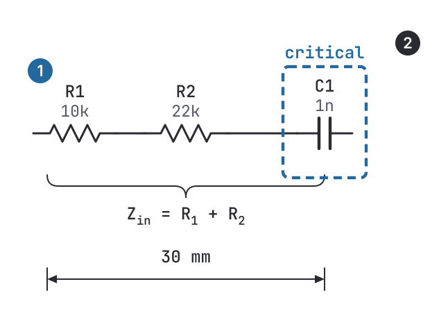
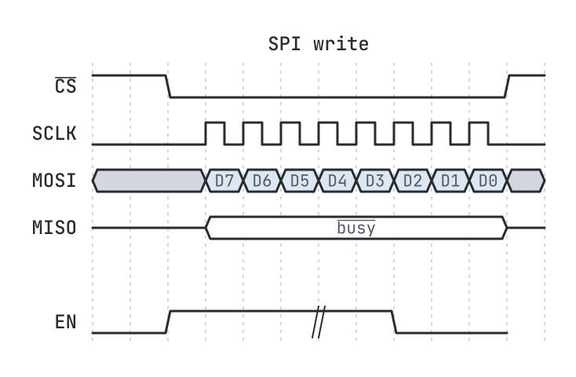

# Annotations and timing diagrams

The **Annotation** palette category holds drawing aids that are not circuit parts: they have no pins and stay out
of netlists and bills of materials. Like any symbol they move, rotate, take [styles](Styles-and-Themes.md) and
export to every format, TikZ included. Their text takes [markup and `$...$` maths](Text-Markup.md).



## Brace

A curly brace spanning a group of parts, with a label at its tip. *Length* sets the span, *Depth* the size of the
curls; rotate it (`R`) to face down, left or right.

```python
s.brace((140, 60), length=200, text='input network')
s.brace((140, 130), rot=180, length=200, text=r'$Z_{in} = R_1 + R_2$')
```

## Callout

A numbered marker for referring to parts of a figure from the text ("see ① in Figure 3"). *Style*: accent disc,
ink disc or outline.

```python
s.callout((40, 60), number='1')
s.callout((250, 60), number='2', fill='ink')
```

## Dimension

A measurement between two points: a double arrow with extension lines and a label.

```python
s.dimension((140, 200), length=160, text='30 mm', ext=8)
```

## Highlight box

A dashed accent frame that draws the eye to part of a figure, with an optional caption. Rectangles drawn with the
Box tool can use the same look: *Kind > Highlight*.

```python
s.highlight((220, 100), w=60, h=50, text='critical')
s.rect(x, y, w, h, cls='hl')
```

## Timing diagrams

A **Timing diagram** draws waveforms from a short text description, one signal per line, in the style of
[WaveDrom](https://wavedrom.com):

```
~{CS} : 1.0........1
SCLK  : 0..pppppppp0
MOSI  : x..23456789x | D7 D6 D5 D4 D3 D2 D1 D0
MISO  : z..=.......z | $\overline{busy}$

EN    : 0.1...|..0..
```



Each line is `NAME : wave` with optional `| labels` for the data cells. An empty line leaves a gap between groups.

| Wave character | Draws |
|---|---|
| `p` / `n` | clock, rising / falling edge first, one period per character |
| `0` / `1` | low / high (changes are drawn slanted) |
| `z` | high impedance (mid level) |
| `x` | unknown (grey cell) |
| `=` | a data cell, labelled from the list after `\|` |
| `2` … `9` | a shaded data cell, labelled the same way |
| `.` | extends the previous state by one period |
| `\|` | a gap in time (two slanted strokes), taking no time itself |

Settings: *Cycle width* (pixels per period), *Row pitch*, *Signal height*, *Cycle grid* (dashed lines every
period) and an optional *Title*. Names and labels take markup (`~{CS}` for an overbar) and `$...$` maths.

Mark delays and relationships with [arrows](Python-Scripting.md#annotation) and texts on top of the diagram:

```python
td = s.timing((60, 40), title='SPI write', grid=True, signals='CLK : p.......\nDATA: x.=.=..x | A5 3C')
s.arrow((84, 30), (132, 30), style='', head=(6, 3))
s.text(108, 24, '$t_{su}$', 'valsm', 'middle')
```
