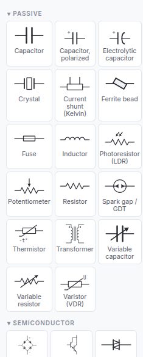
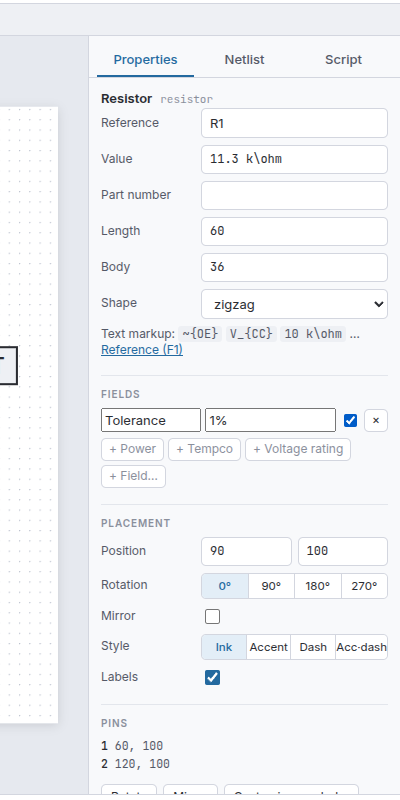
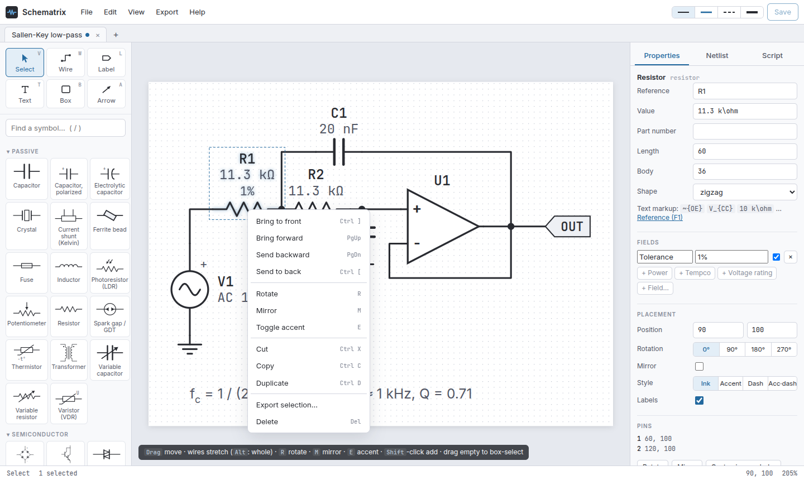
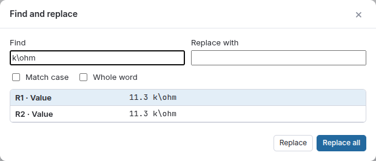

# The editor

From left to right: the **tool buttons** and **symbol palette**, the **sheet**, and the side panes
(**Properties**, **Netlist**, **Script**). Tabs above the sheet hold several schematics at once; the status bar shows
the active tool, the selection and the cursor position. The side panels can be resized by dragging their edges.

## Menus

| Menu | Contents |
|---|---|
| **File** | New schematic, Open from workspace, Open file from computer, Save, Save as, Import netlist, New symbol, Import legacy figure script |
| **Edit** | Undo / redo, cut / copy / paste / duplicate, delete, select all, Find and replace, rotate, mirror, accent, z-order (front, forward, backward, back), align and distribute |
| **View** | Fit, zoom, actual size, grid, junction dots, wire hops |
| **Export** | Export… dialog, Export selection…, quick exports (SVG, PNG, JPEG, PDF, EPS, TikZ), netlists (SPICE, KiCad, JSON), the document (.json), Copy SVG |
| **Help** | Text markup reference (F1), keyboard shortcuts (?) |

The **line-style buttons** at the top right set the style for new wires and parts: ink, accent (blue), dashed, bus.

## Tools

| Tool | Key | Use |
|---|---|---|
| Select | `V` | select, move, box-select, edit |
| Wire | `W` | draw wires; they snap to pins, wire ends and wire middles |
| Label | `L` | click a wire or pin to name its net |
| Text | `T` | click to add a text; type to edit |
| Box | `B` | drag a shaded group box, a frame or a block outline |
| Arrow | `A` | annotation arrows (accent style) |

Most tools return to Select with `Esc`.

## The palette

- **Search** with the box above (or `/`); it matches titles, names, categories and variants ("zener", "nand",
  "shift register").
- **Fold** a category by clicking its heading (remembered per browser).
- **Variants** such as *Zener diode* or *NAND gate* have their own tiles; they are the same symbol with preset settings
  (see [Symbol library](Symbol-Library.md)).
- **Place**: drag a tile onto the sheet for one part, or click it and then click the sheet repeatedly.
- **Right-click** a tile to start a [custom symbol](Custom-Symbols.md) from it (or to edit a custom one; those carry
  a ✎ mark).

## Selecting and moving

- Click to select; `Shift`/`Ctrl`-click adds or removes.
- **Box-select**: drag on empty space. Left to right selects what is fully inside; right to left selects everything
  it touches.
- **Move** by dragging. Wires attached to a moved part stretch along, staying orthogonal, and wires that tee into
  those wires follow too.
- **Nudge** with the arrow keys (`Shift` = 4 grid steps).
- Locked items (a [page frame](Page-Frames.md)) cannot be selected.

## Wires

- Draw with `W`; see [Wires and connections](Wires-and-Connections.md) for junctions, hops, labels and buses.
- **Drag a wire end** to stretch it (an elbow keeps it orthogonal).
- **Drag the middle of a segment** to slide that segment; its neighbours stretch, a connected end stays put behind a
  new short stub, and wires branching off the segment come along.
- **Alt-drag** moves a whole wire. Double-click a segment to add a corner.

## The Properties pane (inspector)

- **Nothing selected**: the document: title, description, page size (auto or fixed), margin, grid, junction dots,
  wire hops, SPICE lines ([Simulation](Simulation.md)), theme, and the [page frame](Page-Frames.md).
- **A part**: its reference, value, part number and symbol settings (variants like *kind*, *inputs*, *bits*), its
  [fields](Fields-and-Properties.md), placement (position, rotation, mirror, style, labels on/off), its pins, and
  buttons for rotate, mirror, *Edit / Customise symbol…*, z-order and delete. A short reminder links the
  [text markup](Text-Markup.md) reference.
- **A wire / arrow**: style (ink, accent, dashed, accent-dashed, bus) and its points as text.
- **A text**: content, text class, anchor and position. **A box**: kind (group shading, box, accent box, frame),
  label, position, size, corner radius.
- **Several items**: common style, transform buttons, z-order, and **Align / Distribute**.

Typing in a field updates the sheet live; `Enter` commits, and every change is one undo step.

## Editing text

Double-click any text on the sheet (a reference, value, shown field, net label, free text, box label) to edit it in
place. `Enter` commits, `Shift Enter` adds a line, `Esc` cancels. All text understands the
[markup language](Text-Markup.md): press `F1` for the reference, from anywhere.

## The right-click menu

Right-click (without dragging; a right **drag** pans) opens a menu for what is under the cursor: with several items
selected, align and distribute; then z-order, rotate, mirror, accent, cut, copy, duplicate, *Export selection…* and
delete. On empty space: paste, select all, fit, export.

## Z-order

Later elements draw over earlier ones. **Bring to front** (`Ctrl ]`), **Bring forward** (`PgUp`),
**Send backward** (`PgDn`), **Send to back** (`Ctrl [`); also in the inspector and the right-click menu. New group
boxes go to the back automatically.

## Align and distribute

With two or more parts, texts or boxes selected: **Align** left / centre / right / top / middle / bottom (to the
selection's bounding box), or **Distribute** horizontally / vertically (even spacing between the outermost two).
Moves snap to the grid and attached wires stretch along.

## Find and replace

`Ctrl F` searches references, values, part numbers, net names, fields, texts and box labels (raw text and the
rendered text, so `k\ohm` and `kΩ` both match). Click a result to select it and centre it. **Replace** changes the
highlighted hit, **Replace all** every hit (one undo step). Options: match case, whole word.

## Tabs, saving and autosave

- Each tab is one schematic. `Ctrl N` opens a new one; scripts open their results as new tabs.
- **Save** (`Ctrl S`) writes `<name>.json` to the workspace (`~/Schematrix`, or `SCHEMATRIX_WORKSPACE`);
  **Save as** (`Ctrl Shift S`) picks a new name. **Open** (`Ctrl O`) lists the workspace; you can delete files there.
- **Open file from computer** (or drag a file onto the window) opens `.json` documents, netlists (`.cir`, `.net`,
  `.sp`, …), Python scripts and legacy figure scripts.
- Everything is **autosaved** in the browser while you work, and restored when the editor reopens.
- On a [public server](Deployment.md#public-server) Save downloads the `.json` instead (nothing is kept on the
  server).

## The Netlist pane

**Extract netlist** lists every net with its pins and the warnings (unconnected pins, nets named twice, bus width
mismatches). Clicking a net highlights it on the sheet. **Download** saves the netlist as SPICE, KiCad or JSON.

## The Script pane

A Python editor: write a script that builds schematics with the [scripting API](Python-Scripting.md) and run it with
**Run** (`Ctrl Enter`). Every schematic the script creates (or passes to `show()`) opens as a tab; `print()` output
and errors appear below. Scripts can be saved to and loaded from the workspace. Scripts run in a separate process
with a time limit (`SCHEMATRIX_SCRIPT_TIMEOUT`, 30 s); the server owner can switch them off.

## View

`F` fits the sheet to the window, the wheel (or `+` / `-`) zooms around the cursor, `1` shows actual size, `G`
toggles the grid. Pan with the right or middle mouse button, `Space`-drag, or a touchpad two-finger scroll.
