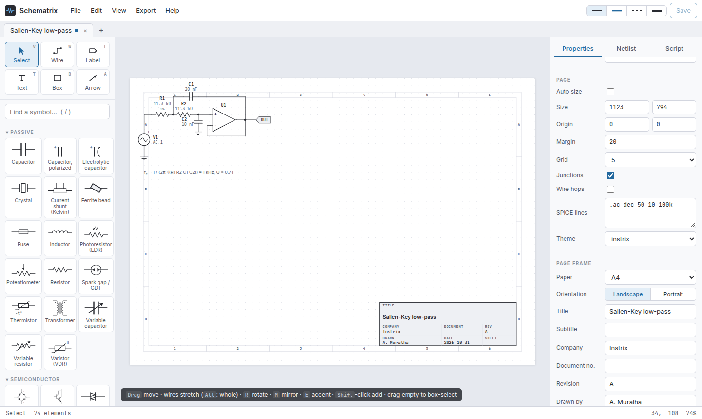

# Page frames

A page frame puts the sheet on a paper size with a drawing border, zone markers (1, 2, 3 … along the top and bottom,
A, B, C … along the sides) and a title block in the bottom-right corner.



## In the editor

With nothing selected, the document inspector has a **Page frame** section:

1. **Paper**: None, A5, A4, A3, A2, A1, Letter, Legal or Tabloid.
2. **Orientation**: landscape or portrait.
3. **Title block** fields: Title, Subtitle, Company, Document no., Revision, Drawn by, Date (today if left empty),
   Sheet.

Changing any of these regenerates the frame. The page switches to the paper size (fixed page, origin at the top-left
corner); drawing coordinates are 96 units per inch, so A4 landscape is 1123 × 794. The frame is **locked**: it cannot
be selected, moved or box-selected by accident, and it never appears in netlists or selection exports. Choose
**None** to remove it.

## In Python

```python
s.frame('A4', title='Front end', subtitle='TR-0003 fig. 2', company='Instrix', doc='TR-0003',
        rev='B', author='A. Muralha', sheet='1 / 1')
s.frame('A3', 'portrait', title='Again')      # replaces the previous frame
s.frame(None)                                  # removes it
```

## Over HTTP

`POST /api/frame` with `{"size": "A4", "orientation": "landscape", "fields": {"title": "…"}}` returns the frame's
elements and the page size (see [HTTP API](HTTP-API.md)).

## Notes

- Frames are made of ordinary rectangles and texts (marked `"frame": true, "locked": true`), so every renderer and
  export, TikZ included, draws them.
- For figures in a paper you usually want **no** frame and the page sized to the drawing (*Auto size*); frames are
  for stand-alone drawings and printouts.
