# Symbol library

Every built-in symbol, generated from the library itself (`python scripts/build_wiki_symbols.py`).
In Python each symbol is a method of `Schematic` (`s.resistor(...)`), and so is each named variant
(`s.zener(...)`). Settings marked *shape* change the drawing; the others are information.

Every part also has **Reference**, **Value** and **Part number**, and can carry any number of
[fields](Fields-and-Properties.md). Pins are named as listed; the netlist uses these names.

**Categories:** [Passive](#passive) · [Semiconductor](#semiconductor) · [Analog](#analog) · [Logic](#logic) · [Sources](#sources) · [Loads & meters](#loads--meters) · [Electromechanical](#electromechanical) · [Vacuum tubes](#vacuum-tubes) · [Signal flow](#signal-flow) · [Generic](#generic) · [Nets](#nets)

## Passive

### Capacitor

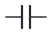

- **Python:** `s.capacitor(...)`  ·  **Reference prefix:** `C`  ·  **SPICE:** `C {1} {2} {value}`
- **Pins:** `1`, `2`
- **Suggested fields:** Voltage rating, Tolerance, Dielectric, ESR

| Setting | Type | Default | |
|---|---|---|---|
| `length` (Length) | num | `40` | *shape* pin-to-pin distance |
| `polarized` (Polarized) | bool | `False` | *shape*  |
| `plate` (Negative plate) | enum: flat, curved | `flat` | *shape* curved: electrolytic style |

**Named variants** (each has its own palette tile and Python method):

| | Variant | Python | Same as |
|---|---|---|---|
| 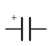 | Capacitor, polarized | `s.capacitor_polarized()` | `capacitor` with polarized=True |
| 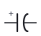 | Electrolytic capacitor | `s.electrolytic()` | `capacitor` with polarized=True, plate='curved' |

### Crystal

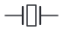

- **Python:** `s.crystal(...)`  ·  **Reference prefix:** `Y`
- **Pins:** `1`, `2`
- **Suggested fields:** Load capacitance, Tolerance, ESR

| Setting | Type | Default | |
|---|---|---|---|
| `length` (Length) | num | `60` | *shape* pin-to-pin distance |

### Current shunt (Kelvin)

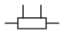

- **Python:** `s.shunt(...)`  ·  **Reference prefix:** `R`  ·  **SPICE:** `R {1} {2} {value}`
- **Pins:** `1`, `2`, `S1`, `S2`
- **Suggested fields:** Tolerance, Power, Tempco, Voltage rating

| Setting | Type | Default | |
|---|---|---|---|
| `length` (Length) | num | `60` | *shape* pin-to-pin distance |

### Ferrite bead

- **Python:** `s.ferrite(...)`  ·  **Reference prefix:** `FB`  ·  **SPICE:** `L {1} {2} {value}`
- **Pins:** `1`, `2`
- **Suggested fields:** Impedance @100MHz, Current rating

| Setting | Type | Default | |
|---|---|---|---|
| `length` (Length) | num | `40` | *shape* pin-to-pin distance |

### Fuse

- **Python:** `s.fuse(...)`  ·  **Reference prefix:** `F`  ·  **SPICE:** `R {1} {2} 10m`
- **Pins:** `1`, `2`
- **Suggested fields:** Current rating, Voltage rating, Speed

| Setting | Type | Default | |
|---|---|---|---|
| `length` (Length) | num | `60` | *shape* pin-to-pin distance |

### Inductor

- **Python:** `s.inductor(...)`  ·  **Reference prefix:** `L`  ·  **SPICE:** `L {1} {2} {value}`
- **Pins:** `1`, `2`
- **Suggested fields:** Current rating, Saturation current, DCR, Tolerance

| Setting | Type | Default | |
|---|---|---|---|
| `length` (Length) | num | `60` | *shape* pin-to-pin distance |
| `body` (Body) | num | `40` | *shape*  |
| `core` (Core) | enum: air, iron, ferrite | `air` | *shape*  |

### Photoresistor (LDR)

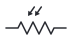

- **Python:** `s.ldr(...)`  ·  **Reference prefix:** `R`  ·  **SPICE:** `R {1} {2} {value}`
- **Pins:** `1`, `2`

| Setting | Type | Default | |
|---|---|---|---|
| `length` (Length) | num | `60` | *shape* pin-to-pin distance |
| `body` (Body) | num | `36` | *shape*  |
| `shape` (Shape) | enum: zigzag, iec | `zigzag` | *shape*  |

### Potentiometer

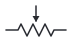

- **Python:** `s.potentiometer(...)`  ·  **Reference prefix:** `RV`
- **Pins:** `1`, `2`, `W`
- **Suggested fields:** Tolerance, Power, Tempco, Voltage rating

| Setting | Type | Default | |
|---|---|---|---|
| `length` (Length) | num | `60` | *shape* pin-to-pin distance |
| `body` (Body) | num | `36` | *shape*  |
| `kind` (Kind) | enum: pot, trimmer | `pot` | *shape*  |

### Resistor

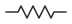

- **Python:** `s.resistor(...)`  ·  **Reference prefix:** `R`  ·  **SPICE:** `R {1} {2} {value}`
- **Pins:** `1`, `2`
- **Suggested fields:** Tolerance, Power, Tempco, Voltage rating

| Setting | Type | Default | |
|---|---|---|---|
| `length` (Length) | num | `60` | *shape* pin-to-pin distance |
| `body` (Body) | num | `36` | *shape*  |
| `shape` (Shape) | enum: zigzag, iec | `zigzag` | *shape*  |

### Spark gap / GDT

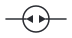

- **Python:** `s.spark_gap(...)`  ·  **Reference prefix:** `E`
- **Pins:** `1`, `2`
- **Suggested fields:** Spark-over voltage

| Setting | Type | Default | |
|---|---|---|---|
| `length` (Length) | num | `60` | *shape* pin-to-pin distance |

### Thermistor

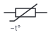

- **Python:** `s.thermistor(...)`  ·  **Reference prefix:** `TH`  ·  **SPICE:** `R {1} {2} {value}`
- **Pins:** `1`, `2`
- **Suggested fields:** Beta, R25, Tolerance

| Setting | Type | Default | |
|---|---|---|---|
| `length` (Length) | num | `60` | *shape* pin-to-pin distance |
| `kind` (Kind) | enum: ntc, ptc | `ntc` | *shape*  |

### Transformer

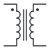

- **Python:** `s.transformer(...)`  ·  **Reference prefix:** `T`
- **Pins:** `P1`, `P2`, `S1`, `S2`
- **Suggested fields:** Turns ratio, Power, Isolation

| Setting | Type | Default | |
|---|---|---|---|
| `core` (Core) | enum: air, iron, ferrite | `iron` | *shape*  |
| `ct` (Centre tap) | bool | `False` | *shape*  |
| `dots` (Polarity dots) | bool | `True` | *shape*  |

### Variable capacitor

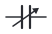

- **Python:** `s.cvar(...)`  ·  **Reference prefix:** `C`  ·  **SPICE:** `C {1} {2} {value}`
- **Pins:** `1`, `2`
- **Suggested fields:** Voltage rating, Tolerance, Dielectric, ESR

| Setting | Type | Default | |
|---|---|---|---|
| `length` (Length) | num | `40` | *shape* pin-to-pin distance |
| `kind` (Kind) | enum: variable, trimmer | `variable` | *shape*  |

### Variable resistor

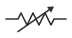

- **Python:** `s.rvar(...)`  ·  **Reference prefix:** `R`  ·  **SPICE:** `R {1} {2} {value}`
- **Pins:** `1`, `2`
- **Suggested fields:** Tolerance, Power, Tempco, Voltage rating

| Setting | Type | Default | |
|---|---|---|---|
| `length` (Length) | num | `60` | *shape* pin-to-pin distance |
| `body` (Body) | num | `36` | *shape*  |
| `shape` (Shape) | enum: zigzag, iec | `zigzag` | *shape*  |

### Varistor (VDR)

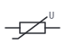

- **Python:** `s.varistor(...)`  ·  **Reference prefix:** `RV`  ·  **SPICE:** `R {1} {2} {value}`
- **Pins:** `1`, `2`
- **Suggested fields:** Clamping voltage, Energy

| Setting | Type | Default | |
|---|---|---|---|
| `length` (Length) | num | `60` | *shape* pin-to-pin distance |

## Semiconductor

### Bridge rectifier

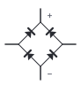

- **Python:** `s.bridge(...)`  ·  **Reference prefix:** `D`
- **Pins:** `AC1`, `AC2`, `+`, `-`
- **Suggested fields:** Reverse voltage, Forward current, Forward voltage, Power

### Darlington (NPN)

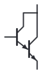

- **Python:** `s.darlington(...)`  ·  **Reference prefix:** `Q`
- **Pins:** `C`, `B`, `E`
- **Suggested fields:** Vce max, Ic max, hFE, Power

### Diac

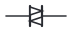

- **Python:** `s.diac(...)`  ·  **Reference prefix:** `D`
- **Pins:** `MT1`, `MT2`

| Setting | Type | Default | |
|---|---|---|---|
| `length` (Length) | num | `60` | *shape* pin-to-pin distance |

### Diode

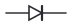

- **Python:** `s.diode(...)`  ·  **Reference prefix:** `D`  ·  **SPICE:** `D {A} {K} {model}`
- **Pins:** `A`, `K`
- **Suggested fields:** Reverse voltage, Forward current, Forward voltage, Power

| Setting | Type | Default | |
|---|---|---|---|
| `length` (Length) | num | `60` | *shape* pin-to-pin distance |
| `kind` (Kind) | enum: standard, schottky, zener, avalanche, tvs, tvs_uni, led, photodiode, varactor, tunnel, pin, laser, step_recovery, shockley | `standard` | *shape*  |

**Named variants** (each has its own palette tile and Python method):

| | Variant | Python | Same as |
|---|---|---|---|
| 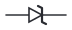 | Zener diode | `s.zener()` | `diode` with kind='zener' |
| 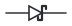 | Schottky diode | `s.schottky()` | `diode` with kind='schottky' |
| 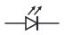 | LED | `s.led()` | `diode` with kind='led' |
| 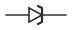 | TVS diode | `s.tvs_diode()` | `diode` with kind='tvs_uni' |
|  | TVS diode, bidirectional | `s.tvs_bidirectional()` | `diode` with kind='tvs' |
| 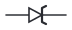 | Avalanche diode | `s.avalanche_diode()` | `diode` with kind='avalanche' |
| 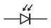 | Photodiode | `s.photodiode()` | `diode` with kind='photodiode' |
| 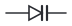 | Varactor (varicap) | `s.varactor()` | `diode` with kind='varactor' |
| 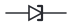 | Tunnel diode | `s.tunnel_diode()` | `diode` with kind='tunnel' |
| 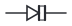 | PIN diode | `s.pin_diode()` | `diode` with kind='pin' |
| 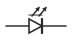 | Laser diode | `s.laser_diode()` | `diode` with kind='laser' |
| 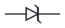 | Step-recovery diode | `s.step_recovery_diode()` | `diode` with kind='step_recovery' |
| 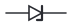 | Shockley (4-layer) diode | `s.shockley_diode()` | `diode` with kind='shockley' |

### IGBT

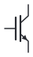

- **Python:** `s.igbt(...)`  ·  **Reference prefix:** `Q`
- **Pins:** `C`, `G`, `E`
- **Suggested fields:** Vce max, Ic max, Vce(sat)

| Setting | Type | Default | |
|---|---|---|---|
| `body_diode` (Freewheel diode) | bool | `False` | *shape*  |

### N-JFET

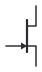

- **Python:** `s.njfet(...)`  ·  **Reference prefix:** `Q`  ·  **SPICE:** `J {D} {G} {S} {model}`
- **Pins:** `D`, `G`, `S`

### N-MOSFET

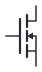

- **Python:** `s.nmos(...)`  ·  **Reference prefix:** `Q`  ·  **SPICE:** `M {D} {G} {S} {B|S} {model}`
- **Pins:** `D`, `G`, `S`
- **Suggested fields:** Vds max, Id max, Rds(on), Vgs(th)

| Setting | Type | Default | |
|---|---|---|---|
| `body_diode` (Body diode) | bool | `False` | *shape*  |
| `mode` (Mode) | enum: enhancement, depletion | `enhancement` | *shape*  |
| `bulk` (Bulk pin) | bool | `False` | *shape* 4-terminal: separate body connection |

### NPN transistor

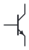

- **Python:** `s.npn(...)`  ·  **Reference prefix:** `Q`  ·  **SPICE:** `Q {C} {B} {E} {model}`
- **Pins:** `C`, `B`, `E`
- **Suggested fields:** Vce max, Ic max, hFE, Power

| Setting | Type | Default | |
|---|---|---|---|
| `envelope` (Circle) | bool | `False` | *shape*  |
| `photo` (Phototransistor) | bool | `False` | *shape*  |

### Optocoupler

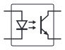

- **Python:** `s.optocoupler(...)`  ·  **Reference prefix:** `U`
- **Pins:** `A`, `K`, `C`, `E`
- **Suggested fields:** CTR, Isolation

| Setting | Type | Default | |
|---|---|---|---|
| `output` (Output) | enum: transistor, triac | `transistor` | *shape*  |

### P-JFET

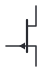

- **Python:** `s.pjfet(...)`  ·  **Reference prefix:** `Q`  ·  **SPICE:** `J {D} {G} {S} {model}`
- **Pins:** `D`, `G`, `S`

### P-MOSFET

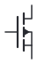

- **Python:** `s.pmos(...)`  ·  **Reference prefix:** `Q`  ·  **SPICE:** `M {D} {G} {S} {B|S} {model}`
- **Pins:** `D`, `G`, `S`
- **Suggested fields:** Vds max, Id max, Rds(on), Vgs(th)

| Setting | Type | Default | |
|---|---|---|---|
| `body_diode` (Body diode) | bool | `False` | *shape*  |
| `mode` (Mode) | enum: enhancement, depletion | `enhancement` | *shape*  |
| `bulk` (Bulk pin) | bool | `False` | *shape* 4-terminal: separate body connection |

### PNP transistor

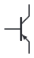

- **Python:** `s.pnp(...)`  ·  **Reference prefix:** `Q`  ·  **SPICE:** `Q {C} {B} {E} {model}`
- **Pins:** `C`, `B`, `E`
- **Suggested fields:** Vce max, Ic max, hFE, Power

| Setting | Type | Default | |
|---|---|---|---|
| `envelope` (Circle) | bool | `False` | *shape*  |
| `photo` (Phototransistor) | bool | `False` | *shape*  |

### Thyristor (SCR)

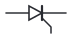

- **Python:** `s.scr(...)`  ·  **Reference prefix:** `D`
- **Pins:** `A`, `K`, `G`
- **Suggested fields:** Reverse voltage, Forward current, Forward voltage, Power

| Setting | Type | Default | |
|---|---|---|---|
| `length` (Length) | num | `60` | *shape* pin-to-pin distance |

### Triac

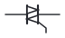

- **Python:** `s.triac(...)`  ·  **Reference prefix:** `Q`
- **Pins:** `MT1`, `MT2`, `G`

| Setting | Type | Default | |
|---|---|---|---|
| `length` (Length) | num | `60` | *shape* pin-to-pin distance |

## Analog

### Fully differential amp

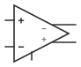

- **Python:** `s.fdamp(...)`  ·  **Reference prefix:** `U`
- **Pins:** `inp`, `inm`, `outm`, `outp`, `vocm`
- **Suggested fields:** GBW, Supply range

| Setting | Type | Default | |
|---|---|---|---|
| `vocm` (VOCM pin) | bool | `True` | *shape*  |

### Instrumentation amp

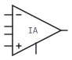

- **Python:** `s.inamp(...)`  ·  **Reference prefix:** `U`
- **Pins:** `inm`, `inp`, `out`, `rg1`, `rg2`, `ref`
- **Suggested fields:** Gain, CMRR, Supply range

| Setting | Type | Default | |
|---|---|---|---|
| `rg` (Gain pins (RG)) | bool | `True` | *shape*  |

### Op-amp

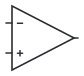

- **Python:** `s.opamp(...)`  ·  **Reference prefix:** `U`  ·  **SPICE:** `X {inp} {inm} {vp?} {vn?} {out} {model}`
- **Pins:** `inm`, `inp`, `out`
- **Suggested fields:** GBW, Slew rate, Supply range, Offset

| Setting | Type | Default | |
|---|---|---|---|
| `top` (Top input) | enum: -, + | `-` | *shape*  |
| `supply` (Supply pins) | bool | `False` | *shape*  |
| `comparator` (Comparator) | bool | `False` | *shape* draws the step mark |

### Sensor (generic)

- **Python:** `s.sensor(...)`  ·  **Reference prefix:** `U`
- **Pins:** `1`, `2`
- **Suggested fields:** Range, Accuracy, Interface

| Setting | Type | Default | |
|---|---|---|---|
| `quantity` (Quantity) | str | `T` | *shape* letter or short text inside, e.g. T, P, B, RH |

### Shunt reference (TL431)

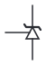

- **Python:** `s.vref(...)`  ·  **Reference prefix:** `U`
- **Pins:** `K`, `A`, `REF`
- **Suggested fields:** Reference voltage, Tolerance

### Voltage regulator

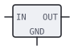

- **Python:** `s.regulator(...)`  ·  **Reference prefix:** `U`  ·  **SPICE:** `X {IN} {GND} {OUT} {model}`
- **Pins:** `IN`, `OUT`, `GND`
- **Suggested fields:** Output voltage, Dropout, Max current

| Setting | Type | Default | |
|---|---|---|---|
| `kind` (Kind) | enum: fixed, adjustable | `fixed` | *shape*  |
| `enable` (Enable pin) | bool | `False` | *shape*  |

## Logic

### Adder

- **Python:** `s.adder(...)`  ·  **Reference prefix:** `U`
- **Pins:** `A0`, `A1`, `A2`, `A3`, `B0`, `B1`, `B2`, `B3`, `CI`, `S0`, `S1`, `S2`, `S3`, `CO`

| Setting | Type | Default | |
|---|---|---|---|
| `bits` (Bits) | num | `4` | *shape* port width in bits |
| `carry_in` (Carry in) | bool | `True` | *shape*  |
| `carry_out` (Carry out) | bool | `True` | *shape*  |
| `bus` (Bus pins) | bool | `False` | *shape* one thick bus pin per port instead of one pin per bit |

**Named variants** (each has its own palette tile and Python method):

| | Variant | Python | Same as |
|---|---|---|---|
| 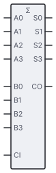 | Adder, 4-bit | `s.adder4()` | `adder` with the defaults |

### Buffer / inverter

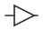

- **Python:** `s.buffer(...)`  ·  **Reference prefix:** `U`
- **Pins:** `in`, `out`

| Setting | Type | Default | |
|---|---|---|---|
| `invert` (Inverting) | bool | `False` | *shape*  |
| `size` (Size) | num | `22` | *shape*  |
| `schmitt` (Schmitt trigger) | bool | `False` | *shape*  |
| `tristate` (Tri-state (OE pin)) | bool | `False` | *shape*  |
| `shape` (Shape) | enum: ansi, iec | `ansi` | *shape* ansi: distinctive shapes; iec: rectangles with &, ≥1, =1, 1 |

**Named variants** (each has its own palette tile and Python method):

| | Variant | Python | Same as |
|---|---|---|---|
|  | Buffer | `s.buffer_gate()` | `buffer` with the defaults |
| 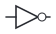 | NOT gate (inverter) | `s.not_gate()` | `buffer` with invert=True |
| 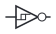 | Schmitt inverter | `s.schmitt_inverter()` | `buffer` with invert=True, schmitt=True |
| 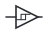 | Schmitt buffer | `s.schmitt_buffer()` | `buffer` with schmitt=True |
|  | Tri-state buffer | `s.tristate_buffer()` | `buffer` with tristate=True |

### Counter

- **Python:** `s.counter(...)`  ·  **Reference prefix:** `U`
- **Pins:** `D0`, `D1`, `D2`, `D3`, `LD`, `EN`, `CLK`, `CLR`, `Q0`, `Q1`, `Q2`, `Q3`, `CO`

| Setting | Type | Default | |
|---|---|---|---|
| `bits` (Bits) | num | `4` | *shape* port width in bits |
| `direction` (Direction) | enum: up, updown | `up` | *shape*  |
| `load` (Parallel load) | bool | `True` | *shape*  |
| `enable` (Count enable) | bool | `True` | *shape*  |
| `clear` (Clear) | bool | `True` | *shape*  |
| `carry` (Carry out) | bool | `True` | *shape*  |
| `bus` (Bus pins) | bool | `False` | *shape* one thick bus pin per port instead of one pin per bit |

**Named variants** (each has its own palette tile and Python method):

| | Variant | Python | Same as |
|---|---|---|---|
|  | Counter, binary | `s.counter4()` | `counter` with the defaults |
|  | Counter, up / down | `s.counter_updown()` | `counter` with direction='updown' |
|  | Ripple counter | `s.ripple_counter()` | `counter` with bits=12, load=False, enable=False, carry=False |

### Decoder / demultiplexer

- **Python:** `s.decoder(...)`  ·  **Reference prefix:** `U`
- **Pins:** `A0`, `A1`, `A2`, `E`, `Y0`, `Y1`, `Y2`, `Y3`, `Y4`, `Y5`, `Y6`, `Y7`

| Setting | Type | Default | |
|---|---|---|---|
| `inputs` (Address bits) | num | `3` | *shape* 1 to 5: 2, 4, 8, 16 or 32 outputs |
| `active_low` (Active-low outputs) | bool | `True` | *shape*  |
| `enable` (Enable) | bool | `True` | *shape*  |
| `bus` (Bus pins) | bool | `False` | *shape* one thick bus pin per port instead of one pin per bit |

**Named variants** (each has its own palette tile and Python method):

| | Variant | Python | Same as |
|---|---|---|---|
|  | Decoder 2:4 | `s.decoder_2to4()` | `decoder` with inputs=2 |
|  | Decoder 3:8 | `s.decoder_3to8()` | `decoder` with the defaults |
|  | Decoder 4:16 | `s.decoder_4to16()` | `decoder` with inputs=4 |

### Demultiplexer (data)

- **Python:** `s.demux(...)`  ·  **Reference prefix:** `U`
- **Pins:** `D`, `S0`, `S1`, `E`, `Y0`, `Y1`, `Y2`, `Y3`

| Setting | Type | Default | |
|---|---|---|---|
| `outputs` (Outputs) | enum: 2, 4, 8, 16 | `4` | *shape*  |
| `width` (Data width) | num | `1` | *shape* bits per port |
| `enable` (Enable) | bool | `True` | *shape*  |
| `bus` (Bus pins) | bool | `False` | *shape* one thick bus pin per port instead of one pin per bit |

### Flip-flop / latch

- **Python:** `s.flipflop(...)`  ·  **Reference prefix:** `U`
- **Pins:** `D`, `CLK`, `Q`, `QN`

| Setting | Type | Default | |
|---|---|---|---|
| `kind` (Kind) | enum: d, jk, t, sr, d-latch | `d` | *shape*  |
| `set_reset` (Async set / reset) | bool | `False` | *shape*  |
| `qbar` (Q̄ output) | bool | `True` | *shape*  |

**Named variants** (each has its own palette tile and Python method):

| | Variant | Python | Same as |
|---|---|---|---|
|  | D flip-flop | `s.dff()` | `flipflop` with the defaults |
|  | D flip-flop, set / reset | `s.dff_sr()` | `flipflop` with set_reset=True |
|  | JK flip-flop | `s.jkff()` | `flipflop` with kind='jk' |
|  | T flip-flop | `s.tff()` | `flipflop` with kind='t' |
|  | SR latch | `s.sr_latch()` | `flipflop` with kind='sr' |
|  | D latch | `s.d_latch()` | `flipflop` with kind='d-latch' |

### Logic IC (custom)

- **Python:** `s.logic_ic(...)`  ·  **Reference prefix:** `U`
- **Pins:** `D`, `CLK`, `OE`, `Q`
- pins: comma list; ~ = active low (bubble), > = clock, [n] = n-bit bus, empty item = gap

| Setting | Type | Default | |
|---|---|---|---|
| `title` (Function) | str | `IC` | *shape* text inside the top of the body |
| `left` (Left pins) | str | `D[8], , >CLK, ~OE` | *shape*  |
| `right` (Right pins) | str | `Q[8]` | *shape*  |
| `top` (Top pins) | str | `` | *shape*  |
| `bottom` (Bottom pins) | str | `` | *shape*  |
| `bus` (Bus pins) | bool | `True` | *shape* off: expand D[8] into D0..D7 |
| `min_width` (Min width) | num | `40` | *shape*  |

### Logic gate

- **Python:** `s.gate(...)`  ·  **Reference prefix:** `U`
- **Pins:** `in1`, `in2`, `out`

| Setting | Type | Default | |
|---|---|---|---|
| `kind` (Kind) | enum: and, nand, or, nor, xor, xnor | `and` | *shape*  |
| `inputs` (Inputs) | num | `2` | *shape* 2 to 16 |
| `invert_inputs` (Inverted inputs) | str | `` | *shape* input numbers with a bubble, e.g. "1, 3" or "all" |
| `shape` (Shape) | enum: ansi, iec | `ansi` | *shape* ansi: distinctive shapes; iec: rectangles with &, ≥1, =1, 1 |
| `schmitt` (Schmitt inputs) | bool | `False` | *shape*  |

**Named variants** (each has its own palette tile and Python method):

| | Variant | Python | Same as |
|---|---|---|---|
|  | AND gate | `s.and_gate()` | `gate` with the defaults |
|  | NAND gate | `s.nand_gate()` | `gate` with kind='nand' |
|  | OR gate | `s.or_gate()` | `gate` with kind='or' |
|  | NOR gate | `s.nor_gate()` | `gate` with kind='nor' |
|  | XOR gate | `s.xor_gate()` | `gate` with kind='xor' |
|  | XNOR gate | `s.xnor_gate()` | `gate` with kind='xnor' |

### Magnitude comparator

- **Python:** `s.magcomp(...)`  ·  **Reference prefix:** `U`
- **Pins:** `A0`, `A1`, `A2`, `A3`, `B0`, `B1`, `B2`, `B3`, `LT`, `EQ`, `GT`

| Setting | Type | Default | |
|---|---|---|---|
| `bits` (Bits) | num | `4` | *shape* port width in bits |
| `cascade` (Cascade inputs) | bool | `False` | *shape*  |
| `bus` (Bus pins) | bool | `False` | *shape* one thick bus pin per port instead of one pin per bit |

**Named variants** (each has its own palette tile and Python method):

| | Variant | Python | Same as |
|---|---|---|---|
|  | Magnitude comparator | `s.magnitude_comparator()` | `magcomp` with the defaults |

### Multiplexer

- **Python:** `s.mux(...)`  ·  **Reference prefix:** `U`
- **Pins:** `I0`, `I1`, `Y`, `S0`

| Setting | Type | Default | |
|---|---|---|---|
| `inputs` (Inputs) | enum: 2, 4, 8, 16 | `2` | *shape*  |
| `width` (Data width) | num | `1` | *shape* bits per input (bus) |
| `enable` (Enable pin) | bool | `False` | *shape*  |

**Named variants** (each has its own palette tile and Python method):

| | Variant | Python | Same as |
|---|---|---|---|
|  | Multiplexer 2:1 | `s.mux2()` | `mux` with the defaults |
|  | Multiplexer 4:1 | `s.mux4()` | `mux` with inputs=4 |
|  | Multiplexer 8:1 | `s.mux8()` | `mux` with inputs=8 |
|  | Multiplexer 16:1 | `s.mux16()` | `mux` with inputs=16 |

### Priority encoder

- **Python:** `s.encoder(...)`  ·  **Reference prefix:** `U`
- **Pins:** `I0`, `I1`, `I2`, `I3`, `I4`, `I5`, `I6`, `I7`, `EI`, `A0`, `A1`, `A2`, `GS`, `EO`

| Setting | Type | Default | |
|---|---|---|---|
| `outputs` (Output bits) | num | `3` | *shape* 1 to 5: 2, 4, 8, 16 or 32 inputs |
| `active_low` (Active-low) | bool | `True` | *shape*  |
| `enable` (Enable in / out) | bool | `True` | *shape*  |
| `bus` (Bus pins) | bool | `False` | *shape* one thick bus pin per port instead of one pin per bit |

**Named variants** (each has its own palette tile and Python method):

| | Variant | Python | Same as |
|---|---|---|---|
|  | Priority encoder 8:3 | `s.priority_encoder()` | `encoder` with the defaults |

### Register / latch array

- **Python:** `s.register(...)`  ·  **Reference prefix:** `U`
- **Pins:** `D0`, `D1`, `D2`, `D3`, `D4`, `D5`, `D6`, `D7`, `CLK`, `OE`, `Q0`, `Q1`, `Q2`, `Q3`, `Q4`, `Q5`, `Q6`, `Q7`

| Setting | Type | Default | |
|---|---|---|---|
| `bits` (Bits) | num | `8` | *shape* port width in bits |
| `kind` (Kind) | enum: flip-flop, latch | `flip-flop` | *shape*  |
| `bus` (Bus pins) | bool | `False` | *shape* one thick bus pin per port instead of one pin per bit |
| `oe` (Output enable) | bool | `True` | *shape*  |
| `clear` (Clear) | bool | `False` | *shape*  |

**Named variants** (each has its own palette tile and Python method):

| | Variant | Python | Same as |
|---|---|---|---|
|  | Register (D flip-flops) | `s.register8()` | `register` with the defaults |
|  | Transparent latch | `s.latch8()` | `register` with kind='latch' |

### Shift register

- **Python:** `s.shiftreg(...)`  ·  **Reference prefix:** `U`
- **Pins:** `SER`, `CLK`, `CLR`, `Q0`, `Q1`, `Q2`, `Q3`, `Q4`, `Q5`, `Q6`, `Q7`, `QS`

| Setting | Type | Default | |
|---|---|---|---|
| `bits` (Bits) | num | `8` | *shape* port width in bits |
| `mode` (Mode) | enum: sipo, piso, siso, pipo | `sipo` | *shape* serial / parallel in, serial / parallel out |
| `bus` (Bus pins) | bool | `False` | *shape* one thick bus pin per port instead of one pin per bit |
| `clear` (Clear) | bool | `True` | *shape*  |
| `oe` (Output enable) | bool | `False` | *shape*  |

**Named variants** (each has its own palette tile and Python method):

| | Variant | Python | Same as |
|---|---|---|---|
|  | Shift register, serial in / parallel out | `s.shiftreg_sipo()` | `shiftreg` with the defaults |
|  | Shift register, parallel in / serial out | `s.shiftreg_piso()` | `shiftreg` with mode='piso' |
|  | Shift register, universal | `s.shiftreg_universal()` | `shiftreg` with mode='pipo', bits=4 |

## Sources

### Battery / cell

- **Python:** `s.battery(...)`  ·  **Reference prefix:** `BT`  ·  **SPICE:** `V {p} {n} {src}`
- **Pins:** `p`, `n`
- **Suggested fields:** Capacity, Chemistry, Internal resistance

| Setting | Type | Default | |
|---|---|---|---|
| `length` (Length) | num | `40` | *shape* pin-to-pin distance |
| `cells` (Cells) | enum: 1, 2, 3, 4 | `1` | *shape*  |

### Current sink

- **Python:** `s.isink(...)`  ·  **Reference prefix:** `I`  ·  **SPICE:** `I {in} {out} {src}`
- **Pins:** `in`, `out`
- drawn vertically: current flows in at the top and out at the bottom
- **Suggested fields:** Compliance voltage

| Setting | Type | Default | |
|---|---|---|---|
| `length` (Length) | num | `80` | *shape* pin-to-pin distance |

### Current source

- **Python:** `s.isrc(...)`  ·  **Reference prefix:** `I`  ·  **SPICE:** `I {p} {n} {src}`
- **Pins:** `p`, `n`
- **Suggested fields:** Compliance voltage

| Setting | Type | Default | |
|---|---|---|---|
| `length` (Length) | num | `100` | *shape* pin-to-pin distance |
| `text` (Text inside) | str | `` | *shape* e.g. e_{n}: drawn in the circle instead of the symbol |

### Current-controlled I source (F)

- **Python:** `s.cccs(...)`  ·  **Reference prefix:** `F`  ·  **SPICE:** `F {p} {n} {ctrl} {value}`
- **Pins:** `p`, `n`

| Setting | Type | Default | |
|---|---|---|---|
| `length` (Length) | num | `100` | *shape* pin-to-pin distance |
| `control` (Controlling source) | str | `V1` |  name of the voltage source whose current controls this one |

### Current-controlled V source (H)

- **Python:** `s.ccvs(...)`  ·  **Reference prefix:** `H`  ·  **SPICE:** `H {p} {n} {ctrl} {value}`
- **Pins:** `p`, `n`

| Setting | Type | Default | |
|---|---|---|---|
| `length` (Length) | num | `100` | *shape* pin-to-pin distance |
| `control` (Controlling source) | str | `V1` |  name of the voltage source whose current controls this one |

### Generator / alternator

- **Python:** `s.generator(...)`  ·  **Reference prefix:** `G`
- **Pins:** `1`, `2`

| Setting | Type | Default | |
|---|---|---|---|
| `length` (Length) | num | `100` | *shape* pin-to-pin distance |
| `letter` (Letter) | str | `G` |   |

### Solar cell

- **Python:** `s.solar(...)`  ·  **Reference prefix:** `SC`
- **Pins:** `p`, `n`
- **Suggested fields:** Voc, Isc, Power

| Setting | Type | Default | |
|---|---|---|---|
| `length` (Length) | num | `40` | *shape* pin-to-pin distance |

### Voltage source

- **Python:** `s.vsrc(...)`  ·  **Reference prefix:** `V`  ·  **SPICE:** `V {p} {n} {src}`
- **Pins:** `p`, `n`
- **Suggested fields:** Amplitude, Frequency, Offset, Output impedance

| Setting | Type | Default | |
|---|---|---|---|
| `length` (Length) | num | `100` | *shape* pin-to-pin distance |
| `kind` (Kind) | enum: dc, ac, pulse, square, triangle, noise | `dc` | *shape*  |
| `text` (Text inside) | str | `` | *shape* e.g. e_{n}: drawn in the circle instead of the symbol |
| `signs` (Polarity signs) | bool | `True` | *shape*  |

### Voltage-controlled I source (G)

- **Python:** `s.vccs(...)`  ·  **Reference prefix:** `G`  ·  **SPICE:** `G {p} {n} {cp} {cn} {value}`
- **Pins:** `p`, `n`, `cp`, `cn`

| Setting | Type | Default | |
|---|---|---|---|
| `length` (Length) | num | `100` | *shape* pin-to-pin distance |

### Voltage-controlled V source (E)

- **Python:** `s.vcvs(...)`  ·  **Reference prefix:** `E`  ·  **SPICE:** `E {p} {n} {cp} {cn} {value}`
- **Pins:** `p`, `n`, `cp`, `cn`

| Setting | Type | Default | |
|---|---|---|---|
| `length` (Length) | num | `100` | *shape* pin-to-pin distance |

## Loads & meters

### Buzzer / piezo

- **Python:** `s.buzzer(...)`  ·  **Reference prefix:** `BZ`
- **Pins:** `1`, `2`
- **Suggested fields:** Voltage, Frequency

| Setting | Type | Default | |
|---|---|---|---|
| `length` (Length) | num | `60` | *shape* pin-to-pin distance |

### Electronic load

- **Python:** `s.load(...)`  ·  **Reference prefix:** `RL`
- **Pins:** `1`, `2`
- a generic load or DUT drawn as a box
- **Suggested fields:** Mode, Setpoint, Power

| Setting | Type | Default | |
|---|---|---|---|
| `length` (Length) | num | `60` | *shape* pin-to-pin distance |
| `label` (Label) | str | `LOAD` |   |
| `w` (Body length) | num | `40` | *shape* along the leads |
| `h` (Body width) | num | `20` | *shape* across the leads |
| `fill` (Fill) | enum: box, pad | `box` | *shape* box = shaded, pad = white |

### Heater

- **Python:** `s.heater(...)`  ·  **Reference prefix:** `HE`  ·  **SPICE:** `R {1} {2} {value}`
- **Pins:** `1`, `2`
- **Suggested fields:** Power, Voltage

| Setting | Type | Default | |
|---|---|---|---|
| `length` (Length) | num | `60` | *shape* pin-to-pin distance |

### Lamp

- **Python:** `s.lamp(...)`  ·  **Reference prefix:** `LA`
- **Pins:** `1`, `2`
- **Suggested fields:** Voltage, Power

| Setting | Type | Default | |
|---|---|---|---|
| `length` (Length) | num | `60` | *shape* pin-to-pin distance |

### Loudspeaker

- **Python:** `s.speaker(...)`  ·  **Reference prefix:** `LS`
- **Pins:** `1`, `2`
- **Suggested fields:** Impedance, Power

### Meter (V / A / Ω / W …)

- **Python:** `s.meter(...)`  ·  **Reference prefix:** `M`
- **Pins:** `1`, `2`
- **Suggested fields:** Range, Accuracy

| Setting | Type | Default | |
|---|---|---|---|
| `length` (Length) | num | `60` | *shape* pin-to-pin distance |
| `letter` (Quantity) | enum: V, A, Ω, W, Hz, mV, mA, µA, G, T, Osc | `V` | *shape*  |

### Microphone

- **Python:** `s.microphone(...)`  ·  **Reference prefix:** `MK`
- **Pins:** `1`, `2`
- **Suggested fields:** Sensitivity, Bias

### Motor

- **Python:** `s.motor(...)`  ·  **Reference prefix:** `M`
- **Pins:** `1`, `2`
- **Suggested fields:** Voltage, Current, Speed

| Setting | Type | Default | |
|---|---|---|---|
| `length` (Length) | num | `60` | *shape* pin-to-pin distance |
| `kind` (Kind) | enum: dc, ac, stepper | `dc` | *shape*  |

### Test probe / scope tip

- **Python:** `s.probe(...)`  ·  **Reference prefix:** `TP`
- **Pins:** `p`
- a probe touching a net; one pin

## Electromechanical

### Antenna

- **Python:** `s.antenna(...)`  ·  **Reference prefix:** `AE`
- **Pins:** `p`
- **Suggested fields:** Frequency, Gain, Impedance

| Setting | Type | Default | |
|---|---|---|---|
| `kind` (Kind) | enum: monopole, loop, dipole | `monopole` | *shape*  |

### Connector / header

- **Python:** `s.connector(...)`  ·  **Reference prefix:** `J`
- **Pins:** `1`, `2`, `3`, `4`
- **Suggested fields:** Pitch, Mating part

| Setting | Type | Default | |
|---|---|---|---|
| `pins` (Pins) | num | `4` | *shape*  |
| `gender` (Style) | enum: pin, socket | `pin` | *shape*  |

### Jumper / solder bridge

- **Python:** `s.jumper(...)`  ·  **Reference prefix:** `JP`
- **Pins:** `1`, `2`

| Setting | Type | Default | |
|---|---|---|---|
| `length` (Length) | num | `40` | *shape* pin-to-pin distance |
| `closed` (Closed) | bool | `False` | *shape*  |

### Relay

- **Python:** `s.relay(...)`  ·  **Reference prefix:** `K`
- **Pins:** `A1`, `A2`, `COM`, `NO`, `NC`
- **Suggested fields:** Coil voltage, Coil resistance, Contact rating

| Setting | Type | Default | |
|---|---|---|---|
| `contact` (Contact) | enum: spst, spdt | `spdt` | *shape*  |
| `latching` (Latching) | bool | `False` | *shape*  |

### Switch / push button

- **Python:** `s.switch(...)`  ·  **Reference prefix:** `SW`
- **Pins:** `1`, `2`
- **Suggested fields:** Current rating, Voltage rating

| Setting | Type | Default | |
|---|---|---|---|
| `length` (Length) | num | `60` | *shape* pin-to-pin distance |
| `kind` (Kind) | enum: spst, spdt, push_no, push_nc | `spst` | *shape*  |
| `closed` (Closed) | bool | `False` | *shape*  |

## Vacuum tubes

### Pentode

- **Python:** `s.pentode(...)`  ·  **Reference prefix:** `V`
- **Pins:** `P`, `K`, `G1`, `G2`, `G3`
- **Suggested fields:** Heater voltage

| Setting | Type | Default | |
|---|---|---|---|
| `heater` (Heater pins) | bool | `False` | *shape*  |

### Tetrode

- **Python:** `s.tetrode(...)`  ·  **Reference prefix:** `V`
- **Pins:** `P`, `K`, `G1`, `G2`
- **Suggested fields:** Heater voltage

| Setting | Type | Default | |
|---|---|---|---|
| `heater` (Heater pins) | bool | `False` | *shape*  |

### Triode

- **Python:** `s.triode(...)`  ·  **Reference prefix:** `V`
- **Pins:** `P`, `K`, `G`
- **Suggested fields:** Heater voltage, Mu

| Setting | Type | Default | |
|---|---|---|---|
| `heater` (Heater pins) | bool | `False` | *shape*  |

### Vacuum diode

- **Python:** `s.tube_diode(...)`  ·  **Reference prefix:** `V`
- **Pins:** `P`, `K`
- **Suggested fields:** Heater voltage

| Setting | Type | Default | |
|---|---|---|---|
| `heater` (Heater pins) | bool | `False` | *shape*  |

## Signal flow

### Amplifier (block)

- **Python:** `s.amplifier(...)`  ·  **Reference prefix:** `A`
- **Pins:** `in`, `out`
- **Suggested fields:** Gain, Bandwidth

| Setting | Type | Default | |
|---|---|---|---|
| `gain` (Text inside) | str | `` | *shape* e.g. ×10, G, 20 dB |
| `size` (Size) | num | `40` | *shape*  |

### Attenuator / pad

- **Python:** `s.attenuator(...)`  ·  **Reference prefix:** `AT`
- **Pins:** `in`, `out`
- **Suggested fields:** Attenuation, Impedance

### Converter (ADC / DAC / DC-DC)

- **Python:** `s.converter(...)`  ·  **Reference prefix:** `U`
- **Pins:** `in`, `out`
- **Suggested fields:** Resolution, Sample rate, Efficiency

| Setting | Type | Default | |
|---|---|---|---|
| `src` (From) | str | `A` | *shape*  |
| `dst` (To) | str | `D` | *shape*  |
| `isolated` (Isolated) | bool | `False` | *shape*  |

### Filter (block)

- **Python:** `s.filter(...)`  ·  **Reference prefix:** `FL`
- **Pins:** `in`, `out`
- **Suggested fields:** Cut-off, Order, Type

| Setting | Type | Default | |
|---|---|---|---|
| `kind` (Response) | enum: lp, hp, bp, bs | `lp` | *shape*  |

### Mixer / multiplier

- **Python:** `s.mixer(...)`  ·  **Reference prefix:** `MX`
- **Pins:** `rf`, `lo`, `if`

### Oscillator

- **Python:** `s.oscillator(...)`  ·  **Reference prefix:** `X`
- **Pins:** `out`
- **Suggested fields:** Frequency, Stability

### Summing junction

- **Python:** `s.summer(...)`  ·  **Reference prefix:** `S`
- **Pins:** `in1`, `in2`, `out`

| Setting | Type | Default | |
|---|---|---|---|
| `signs` (Signs) | str | `++` | *shape* sign of the left and bottom inputs, e.g. +-  |
| `mark` (Mark) | enum: Σ, +, none | `Σ` | *shape*  |

## Generic

### Block

- **Python:** `s.block(...)`  ·  **Reference prefix:** `U`  ·  **SPICE:** `X {*} {model}`
- **Pins:** 

| Setting | Type | Default | |
|---|---|---|---|
| `w` (Width) | num | `160` | *shape*  |
| `h` (Height) | num | `70` | *shape*  |
| `title` (Title) | str | `Block` | *shape*  |
| `lines` (Lines) | text | `` | *shape*  |
| `pins` (Pins) | str | `` | *shape* e.g. "IN:l, OUT:r, VDD:t@0.5" |
| `accent` (Accent fill) | bool | `False` | *shape*  |
| `show_pins` (Pin names) | bool | `True` | *shape*  |

### IC (DIP-style)

- **Python:** `s.ic(...)`  ·  **Reference prefix:** `U`  ·  **SPICE:** `X {*} {model}`
- **Pins:** `1`, `2`, `3`, `4`, `5`, `6`, `7`, `8`
- pins numbered anticlockwise from top left, like a DIP package

| Setting | Type | Default | |
|---|---|---|---|
| `pins` (Pins) | num | `8` | *shape*  |
| `title` (Title) | str | `IC` | *shape*  |
| `names` (Pin names) | str | `` | *shape* comma list in pin order, e.g. "VCC, IN, OUT, GND" |

### Impedance (generic Z)

- **Python:** `s.impedance(...)`  ·  **Reference prefix:** `Z`
- **Pins:** `1`, `2`

| Setting | Type | Default | |
|---|---|---|---|
| `length` (Length) | num | `60` | *shape* pin-to-pin distance |
| `label` (Text inside) | str | `Z` | *shape*  |
| `w` (Body length) | num | `32` | *shape* along the leads |
| `h` (Body width) | num | `16` | *shape* across the leads |
| `fill` (Fill) | enum: box, pad | `box` | *shape* box = shaded, pad = white |

### Norton equivalent

- **Python:** `s.norton(...)`  ·  **Reference prefix:** `NO`
- **Pins:** `a`, `b`
- value: the short-circuit current

| Setting | Type | Default | |
|---|---|---|---|
| `zn` (Impedance text) | str | `Zn` | *shape*  |

### Thévenin equivalent

- **Python:** `s.thevenin(...)`  ·  **Reference prefix:** `TH`
- **Pins:** `a`, `b`
- value: the open-circuit voltage

| Setting | Type | Default | |
|---|---|---|---|
| `zth` (Impedance text) | str | `Zth` | *shape*  |

### Two-port network

- **Python:** `s.twoport(...)`  ·  **Reference prefix:** `N`  ·  **SPICE:** `X {1} {1n} {2} {2n} {model}`
- **Pins:** `1`, `1n`, `2`, `2n`

| Setting | Type | Default | |
|---|---|---|---|
| `title` (Text inside) | str | `N` | *shape*  |
| `w` (Width) | num | `60` | *shape*  |

## Nets

### Bus entry

- **Python:** `s.busentry(...)`  ·  **Reference prefix:** `—`
- **Pins:** `bus`, `bit`
- the 45° tap from a bus wire to a signal wire; label the bus D[7:0] and the signal D3

| Setting | Type | Default | |
|---|---|---|---|
| `direction` (Direction) | enum: up, down | `up` | *shape*  |

### Ground

- **Python:** `s.ground(...)`  ·  **Reference prefix:** `—`
- **Pins:** `g`

| Setting | Type | Default | |
|---|---|---|---|
| `kind` (Kind) | enum: earth, signal, chassis | `earth` | *shape*  |
| `net` (Net) | str | `0` |   |

### Junction

- **Python:** `s.dot(...)`  ·  **Reference prefix:** `—`
- **Pins:** `p`

### Net label

- **Python:** `s.flag(...)`  ·  **Reference prefix:** `—`
- **Pins:** `p`

| Setting | Type | Default | |
|---|---|---|---|
| `label` (Net name) | str | `NET` | *shape*  |
| `side` (Side) | enum: left, right | `left` | *shape*  |
| `min_width` (Minimum width) | num | `0` | *shape* give several labels the same width, e.g. 60 |

### No-connect mark

- **Python:** `s.noconnect(...)`  ·  **Reference prefix:** `—`
- **Pins:** `p`
- marks a pin as deliberately unconnected

### Supply rail

- **Python:** `s.rail(...)`  ·  **Reference prefix:** `—`
- **Pins:** `p`

| Setting | Type | Default | |
|---|---|---|---|
| `net` (Net) | str | `+5 V` |   |
| `kind` (Kind) | enum: bar, arrow | `bar` | *shape*  |

### Terminal / port

- **Python:** `s.terminal(...)`  ·  **Reference prefix:** `J`
- **Pins:** `p`

| Setting | Type | Default | |
|---|---|---|---|
| `label` (Label) | str | `IN` |   |
| `net` (Net) | str | `` |   |

### Test point

- **Python:** `s.testpoint(...)`  ·  **Reference prefix:** `TP`
- **Pins:** `p`

| Setting | Type | Default | |
|---|---|---|---|
| `kind` (Kind) | enum: loop, pad | `loop` | *shape*  |

